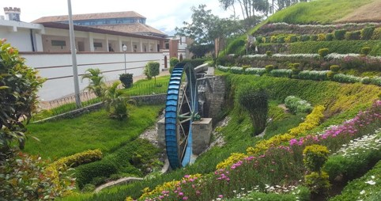
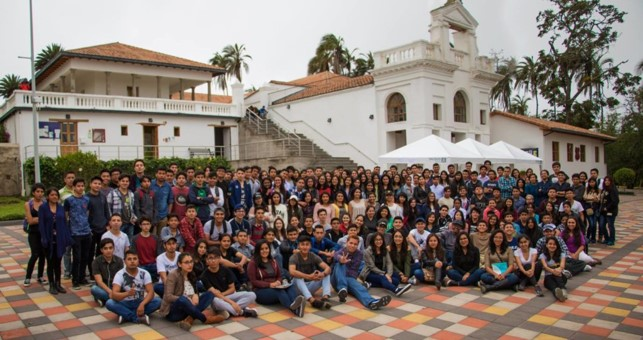

<hr class="new"></hr>
<p class="ptitle"> \ </p>


<div class="row">
  <div class="col-md-5" markdown="1">
  <font size="+1.5">**Lourival Lima, PhD**</font> \
  Associate Professor \
  Department of Mathematical and Computational Sciences \
  Yachay Tech University

  <hr class="new1"></hr>  
  
  **Address** <i class="fas fa-address-card"  style='font-size:16px'></i>  
  <i class="fas fa-map-marker-alt"></i> \ San Miguel de Urcuquí, Hacienda San José s/n Proyecto Yachay, Ibarra - Ecuador

  <hr class="new1"></hr>

  **E-mail** <i class="fas fa-at" style='font-size:16px'></i>  
  lrodrigues@yachaytech.edu.ec  \
  lourivallima15@gmail.com
  
  <hr class="new1"></hr>
  </div>
  
  <div class="col-md-7" markdown="1">
  <iframe src="https://www.google.com/maps/embed?pb=!1m18!1m12!1m3!1d3989.7189794299657!2d-78.17781078626003!3d0.4043207639985602!2m3!1f0!2f0!3f0!3m2!1i1024!2i768!4f13.1!3m3!1m2!1s0x8e2a3a4b5d36ad37%3A0x29804a25cc7029fb!2sYachay%20Tech%20University!5e0!3m2!1spt-BR!2sec!4v1677465209329!5m2!1spt-BR!2sec" width="520" height="400" style="border:0;" allowfullscreen="" loading="lazy" referrerpolicy="no-referrer-when-downgrade"></iframe>
  </div>
  
</div>

\

<h3> **Gallery ** </h3>
<hr class="new1"></hr>

```{r setup, include=FALSE}
knitr::opts_chunk$set(echo = TRUE)
library(magick)
```

<style>
.column-f5{
float: left;
width: 14.28%;
text-align: center;
}
.column-f2c{
float: left;
width: 33.33%;
text-align: center;
}
.row:after {
content: "";
display: table;
clear: both;
}

#myImg {
  border-radius: 5px;
  cursor: pointer;
  transition: 0.3s;
}

#myImg:hover {opacity: 0.7;}

/* The Modal (background) */
.modal {
  display: none; /* Hidden by default */
  position: fixed; /* Stay in place */
  z-index: 1; /* Sit on top */
  padding-top: 100px; /* Location of the box */
  left: 0;
  top: 0;
  width: 100%; /* Full width */
  height: 100%; /* Full height */
  overflow: auto; /* Enable scroll if needed */
  background-color: rgb(0,0,0); /* Fallback color */
  background-color: rgba(0,0,0,0.9); /* Black w/ opacity */
}

/* Modal Content (image) */
.modal-content {
  margin: auto;
  display: block;
  width: 50%;
  max-width: 700px;
}

/* Caption of Modal Image */
#caption {
  margin: auto;
  display: block;
  width: 80%;
  max-width: 700px;
  text-align: center;
  color: #ccc;
  padding: 10px 0;
  height: 150px;
}

/* Add Animation */
.modal-content, #caption {  
  -webkit-animation-name: zoom;
  -webkit-animation-duration: 0.6s;
  animation-name: zoom;
  animation-duration: 0.6s;
}

@-webkit-keyframes zoom {
  from {-webkit-transform:scale(0)} 
  to {-webkit-transform:scale(1)}
}

@keyframes zoom {
  from {transform:scale(0)} 
  to {transform:scale(1)}
}

/* The Close Button */
.close {
  position: absolute;
  top: 45px;
  right: 45px;
  color: #f1f1f1;
  font-size: 40px;
  font-weight: bold;
  transition: 0.3s;
}

.close:hover,
.close:focus {
  color: #bbb;
  text-decoration: none;
  cursor: pointer;
}

/* 100% Image Width on Smaller Screens */
@media only screen and (max-width: 700px){
  .modal-content {
    width: 100%;
  }
}
</style>


<div class="row">

<div class="column-f2c">

<div id="myModal" class="modal">
  <span class="close">&times;</span>
  
  <div id="caption"></div>
</div>
</div>

<div class="column-f2c">

<div id="myModal" class="modal">
  <span class="close">&times;</span>
  
  <div id="caption"></div>
</div>
</div>

<div class="column-f2c">

<div id="myModal" class="modal">
  <span class="close">&times;</span>
  
  <div id="caption"></div>
</div>
</div>
</div>

\

<div class="row">

<div class="column-f2c">

<div id="myModal" class="modal">
  <span class="close">&times;</span>
  
  <div id="caption"></div>
</div>
</div>

<div class="column-f2c">

<div id="myModal" class="modal">
  <span class="close">&times;</span>
  
  <div id="caption"></div>
</div>
</div>

<div class="column-f2c">

<div id="myModal" class="modal">
  <span class="close">&times;</span>
  
  <div id="caption"></div>
</div>
</div>
</div>


