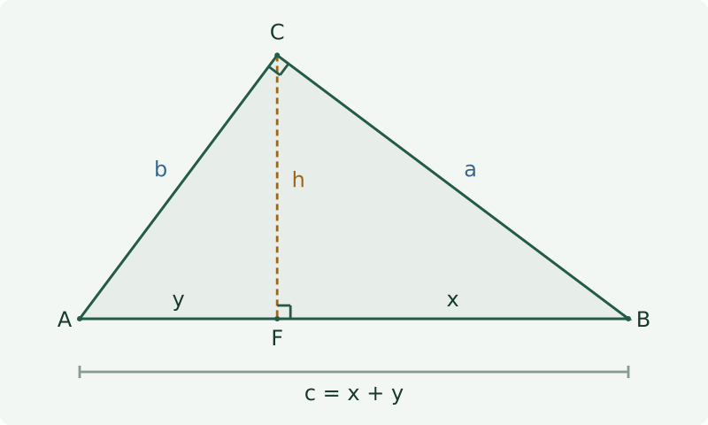
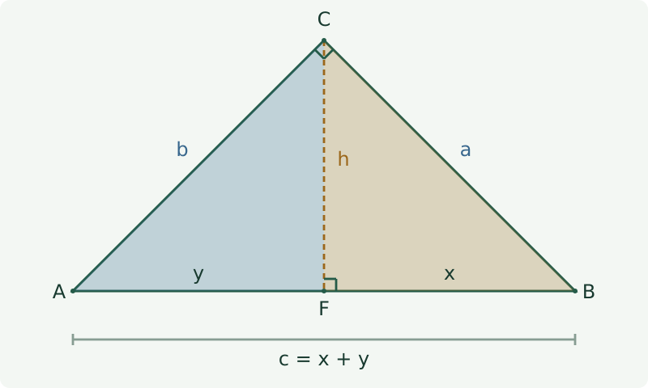

## Configuración y notación

Sea $ABC$ un triángulo rectángulo en $C$ y sea $F$ el pie de la altura desde $C$ a la hipotenusa $AB$. Conservamos la notación de la solución:

$$BC=a,\quad AC=b,\quad AB=c,\quad CF=h,\quad FB=x,\quad AF=y.$$

Todas estas longitudes son positivas, $F$ está entre $A$ y $B$, y $c=x+y$.

<figure class="geometry-figure" id="axiomatic-lesson-2-figure">

<figcaption><strong>Figura 1.</strong> Altura a la hipotenusa. Varíe la posición de F, destaque los triángulos semejantes o seleccione «Caso de igualdad». Las medidas se expresan en una misma unidad; el dibujo se ajusta al ancho disponible.</figcaption>
</figure>

## Literal a · Demostrar que $h^2=xy$

Por el criterio AA, $\triangle ABC\sim\triangle ACF$: comparten el ángulo en $A$ y los ángulos $ACB$ y $AFC$ son rectos. La correspondencia es $A\leftrightarrow A$, $B\leftrightarrow C$, $C\leftrightarrow F$. Por tanto,

$$\frac{c}{b}=\frac{a}{h}=\frac{b}{y}.\tag{1}$$

Análogamente, $\triangle ABC\sim\triangle CBF$: comparten el ángulo en $B$ y los ángulos $ACB$ y $CFB$ son rectos. Ahora la correspondencia es $A\leftrightarrow C$, $B\leftrightarrow B$, $C\leftrightarrow F$, y

$$\frac{c}{a}=\frac{a}{x}=\frac{b}{h}.\tag{2}$$

De (1), $a/h=b/y$, así que $h=ay/b$. De (2), $a/x=b/h$, de donde $a/b=x/h$. Sustituyendo,

$$h=\frac{a}{b}y=\frac{x}{h}y
\quad\Longrightarrow\quad \boxed{h^2=xy}.$$

La altura es la media geométrica de las dos proyecciones: $h=\sqrt{xy}$.

## Literal b · Demostrar que $a^2=cx$ y $b^2=cy$

Del primer y tercer miembro de (1),

$$\frac{c}{b}=\frac{b}{y}\quad\Longrightarrow\quad\boxed{b^2=cy}.$$

Del primer y segundo miembro de (2),

$$\frac{c}{a}=\frac{a}{x}\quad\Longrightarrow\quad\boxed{a^2=cx}.$$

Cada cateto es la media geométrica de la hipotenusa y su proyección sobre ella.

## Literal c · Demostrar que $h=ab/c$

Del literal b, $x=a^2/c$ y $y=b^2/c$. Al sustituir en el literal a,

$$h^2=xy=\frac{a^2}{c}\frac{b^2}{c}=\frac{a^2b^2}{c^2}.$$

Como $a,b,c,h>0$, tomamos la raíz positiva y obtenemos $\boxed{h=ab/c}$.

## Literal d · Obtener el teorema de Pitágoras

Sumamos las dos identidades del literal b y usamos $x+y=c$:

$$a^2+b^2=cx+cy=c(x+y)=c^2.$$

Así, $\boxed{a^2+b^2=c^2}$. Se obtiene esta identidad a partir de la semejanza, sin utilizarla previamente en la demostración.

## Literal e · Demostrar que $h\le c/2$ y estudiar la igualdad

La desigualdad entre la media geométrica y la media aritmética de dos números positivos da

$$h=\sqrt{xy}\le\frac{x+y}{2}=\frac c2.$$

La igualdad ocurre **si y solo si** $x=y$. En efecto,

$$(x+y)^2-4xy=(x-y)^2\ge0,$$

y se anula exactamente cuando $x=y$. Por el literal b, $x=y$ equivale a $a^2=b^2$, es decir, $a=b$. Por tanto,

$$\boxed{h=\frac c2\quad\Longleftrightarrow\quad x=y
\quad\Longleftrightarrow\quad a=b.}$$

El caso de igualdad es el triángulo rectángulo isósceles: $CF$ es simultáneamente altura y mediana, y $x=y=c/2$.

<figure class="geometry-figure">

<figcaption><strong>Figura 2.</strong> Caso de igualdad: x=y, a=b y h=c/2.</figcaption>
</figure>
