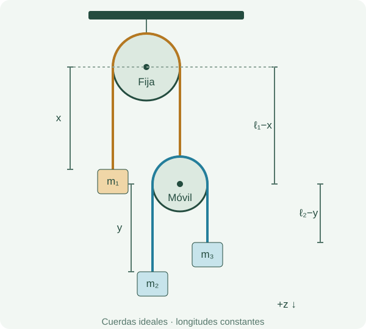

## 1. Promedio en un intervalo que se mueve con el flujo

Supongamos que $f$ es de clase $C^1$ y que $v$ es continua. Los extremos del intervalo se mueven con velocidades $\dot a(t)=v(a(t),t)$ y $\dot b(t)=v(b(t),t)$, con $a(t)<b(t)$.

### Cambio a un intervalo fijo

Siguiendo la pista, escribimos $b(t)-a(t)=\varepsilon h(t)$. Para $0\le s\le1$, definimos
$$
X_s(t)=a(t)+s\varepsilon h(t)=(1-s)a(t)+sb(t).
$$
En el cambio de variable $x=X_s(t)$, se tiene $dx=(b(t)-a(t))\,ds$. Este factor se cancela con el denominador del promedio, de modo que
$$
f_{\mathrm{avg}}(t)=\frac{1}{b(t)-a(t)}\int_{a(t)}^{b(t)}f(x,t)\,dx
=\int_0^1f(X_s(t),t)\,ds.
$$

### Derivada respecto del tiempo

Como los límites de integración son fijos, derivamos bajo el signo integral y aplicamos la regla de la cadena:
$$
\frac{df_{\mathrm{avg}}}{dt}=\int_0^1\left[f_t(X_s(t),t)+f_x(X_s(t),t)\dot X_s(t)\right]\,ds,
$$
$$
\dot X_s(t)=(1-s)v(a(t),t)+s\,v(b(t),t).
$$

### Límite cuando $b(t)\to a(t)$

Para un instante $t$ fijo y todo $s\in[0,1]$,
$$
|X_s(t)-a(t)|\le|b(t)-a(t)|,
$$
$$
|\dot X_s(t)-v(a(t),t)|\le|v(b(t),t)-v(a(t),t)|.
$$
Las cotas son independientes de $s$ y tienden a cero. Por continuidad de $f_t$, $f_x$ y $v$, el integrando converge uniformemente a
$$C(t)=f_t(a(t),t)+v(a(t),t)f_x(a(t),t).$$
Como $C(t)$ es constante respecto de $s$, $\int_0^1C(t)\,ds=C(t)$. Así,
$$
\boxed{\lim_{b\to a}\frac{df_{\mathrm{avg}}}{dt}=f_t(a(t),t)+v(a(t),t)f_x(a(t),t)=\frac{d}{dt}f(a(t),t).}
$$
El resultado mide cómo cambia $f$ para una partícula que sigue el flujo. El término $f_t$ corresponde al cambio temporal en una posición fija y $vf_x$, al cambio debido al desplazamiento de la partícula.

## 2. Sistema de dos poleas

{width=65%}

**Convenciones del modelo.** Las cuerdas son inextensibles y sin masa; las poleas son ideales, sin masa ni fricción. Las constantes $\ell_1$ y $\ell_2$ representan las longitudes disponibles en los tramos rectos, una vez descontados los arcos constantes sobre las poleas. Se toma $g>0$ y $m_i>0$.

### a) Posiciones y velocidades

Medimos todas las posiciones $z_i$ desde el centro de la polea fija, con sentido positivo hacia abajo. La primera cuerda impone que el centro de la polea móvil esté en $\ell_1-x$. Los tramos de la segunda cuerda miden $y$ y $\ell_2-y$, respectivamente. Por tanto,
$$
z_1=x,\qquad z_2=\ell_1-x+y,\qquad z_3=\ell_1-x+\ell_2-y.
$$
Al derivar, usando que las longitudes son constantes, obtenemos
$$
v_1=\dot x,\qquad v_2=-\dot x+\dot y,\qquad v_3=-\dot x-\dot y.
$$
El término $-\dot x$ en $v_2$ y $v_3$ es la velocidad de la polea móvil.

### b) Energías y lagrangiano

La energía cinética es
$$
T=\frac12m_1\dot x^2+\frac12m_2(\dot x-\dot y)^2+\frac12m_3(\dot x+\dot y)^2.
$$
Como $z_i$ aumenta hacia abajo, $U_i=-m_i g z_i$. Al sustituir las posiciones y agrupar los términos,
$$
U=-g\sum_{i=1}^3m_i z_i=g(m_2+m_3-m_1)x+g(m_3-m_2)y+C,
$$
donde $C=-g[(m_2+m_3)\ell_1+m_3\ell_2]$ es constante. Al omitirla en $L=T-U$, resulta
$$
\boxed{L=T+g(m_1-m_2-m_3)x+g(m_2-m_3)y.}
$$

### c) Ecuaciones de movimiento

Para $q=x,y$, usamos
$$
\frac{d}{dt}\left(\frac{\partial L}{\partial\dot q}\right)=\frac{\partial L}{\partial q}.
$$
Las derivadas necesarias son
$$
\begin{aligned}
\frac{\partial L}{\partial\dot x}&=m_1\dot x+m_2(\dot x-\dot y)+m_3(\dot x+\dot y),\\
\frac{\partial L}{\partial x}&=g(m_1-m_2-m_3),\\[4pt]
\frac{\partial L}{\partial\dot y}&=-m_2(\dot x-\dot y)+m_3(\dot x+\dot y),\\
\frac{\partial L}{\partial y}&=g(m_2-m_3).
\end{aligned}
$$
Derivamos respecto del tiempo las expresiones que dependen de las velocidades y agrupamos los términos en $\ddot x$ y $\ddot y$:
$$
\boxed{\begin{aligned}
(m_1+m_2+m_3)\ddot x+(m_3-m_2)\ddot y&=(m_1-m_2-m_3)g,\\
(m_3-m_2)\ddot x+(m_2+m_3)\ddot y&=(m_2-m_3)g.
\end{aligned}}
$$
Estas son las ecuaciones de movimiento del sistema.
