## 3.1 Triángulos semejantes

Estas notas siguen el capítulo 3, **Similarity**, de Leonard, Lewis, Liu y Tokarsky, *Classical Geometry: Euclidean, Transformational, Inversive, and Projective* (2014), pp. 59–93. Se conservan sus ocho secciones, la numeración de resultados y ejercicios, los ejemplos, las cuatro soluciones de 3.7 y los dieciséis problemas de 3.8. La exposición y los dibujos son nuevos. Las precisiones señaladas corrigen ambigüedades de notación o explicitan hipótesis necesarias, dentro de los temas del capítulo.

Trabajamos con triángulos no degenerados. Como antes, $AB$ denota la **longitud** del segmento que une $A$ y $B$; $\overleftrightarrow{AB}$, su recta soporte; $[ABC]$, el área del triángulo; y $C(O,r)$, una circunferencia de centro $O$ y radio $r>0$. En 3.6 se introducirá, por separado, la distancia dirigida $\overline{AB}$.

Dos polígonos son **semejantes** si sus ángulos correspondientes son congruentes y las longitudes de sus lados correspondientes guardan una misma razón. Escribimos $ABCDE\sim QRSTU$. El orden expresa la correspondencia: $A\leftrightarrow Q$, $B\leftrightarrow R$, etc.

En particular, $\triangle ABC\sim\triangle DEF$ significa que

$$\angle A=\angle D,\quad \angle B=\angle E,\quad \angle C=\angle F,$$
$$\frac{AB}{DE}=\frac{BC}{EF}=\frac{AC}{DF}=k>0.$$

El número $k$ es la **constante de proporcionalidad** o **factor de ampliación**. Con este orden de las razones, si $k>1$, $ABC$ es mayor que $DEF$; si $0<k<1$, es menor; si $k=1$, son congruentes. Al invertir el orden de los triángulos, el factor pasa a ser $1/k$. Toda congruencia implica semejanza, pero la recíproca no es cierta.

<figure class="geometry-figure" id="geometry3-fig-1" data-geometry3="similarity">

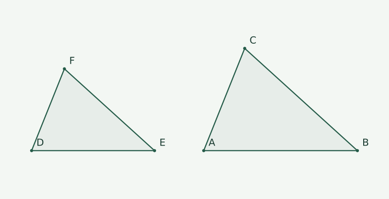

<figcaption><strong>Figura 1.</strong> Triángulos semejantes: la misma forma, con razones de longitudes iguales. El control modifica k respetando el orden ABC/DEF.</figcaption>
</figure>

## 3.2 Rectas paralelas y semejanza

### Proporciones y áreas

**Lema 3.2.1.** En $\triangle ABC$, sean $D\in\overleftrightarrow{AB}$ y $E\in\overleftrightarrow{AC}$, con $DE\parallel BC$. Si la paralela es distinta de $BC$ y no pasa por $A$, entonces

$$\frac{AD}{DB}=\frac{AE}{EC}.$$

Hay tres configuraciones: $D$ está entre $A,B$; más allá de $B$ en la semirrecta $AB$; o más allá de $A$ en la semirrecta $BA$. $E$ ocupa la posición correspondiente sobre $AC$. Aquí se usan longitudes positivas. Decir «puntos de $AB$» debe entenderse sobre la recta cuando se consideran las prolongaciones.

**Teorema 3.2.2.** Si dos triángulos tienen sus bases sobre una recta $l$ y sus vértices opuestos sobre otra recta $m\parallel l$, entonces

$$\frac{[ABC]}{[DEF]}=\frac{BC}{EF}.$$

*Demostración.* Ambos tienen la misma altura $h>0$, que es la distancia entre las paralelas. Dividir $[ABC]=BC\,h/2$ por $[DEF]=EF\,h/2$ da el resultado. En particular, bases iguales y alturas iguales producen áreas iguales. Asimismo, para bases colineales $BC,CD$ y vértice común $A$, $[ABC]/[ACD]=BC/CD$.

*Demostración del lema 3.2.1.* Dibujemos $BE$ y $CD$. Los triángulos $ADE,BDE$ tienen bases $AD,DB$ en una misma recta y la misma altura desde $E$; los triángulos $ADE,CDE$ tienen bases $AE,EC$ y la misma altura desde $D$. Por tanto,

$$\frac{[ADE]}{[BDE]}=\frac{AD}{DB},\qquad
\frac{[ADE]}{[CDE]}=\frac{AE}{EC}.$$

Como $B,C$ están sobre una paralela a $DE$, $[BDE]=[CDE]$. Las dos razones son iguales. El argumento con áreas positivas vale también para las dos configuraciones exteriores.

<figure class="geometry-figure" id="geometry3-fig-2" data-geometry3="parallels">

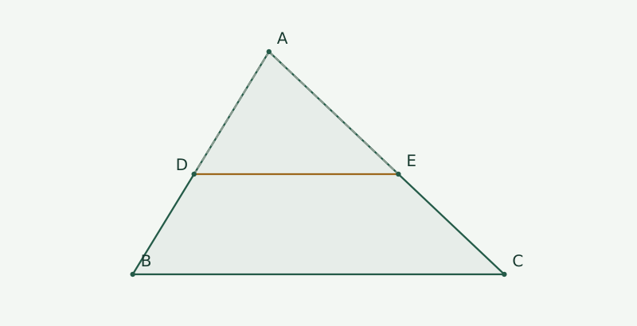

<figcaption><strong>Figura 2.</strong> La paralela DE conserva la proporción en los tres casos. Las posiciones degeneradas D=A y D=B se excluyen de los controles.</figcaption>
</figure>

**Teorema 3.2.3. Las proyecciones paralelas conservan razones.** Sean $l,m,n$ tres rectas paralelas distintas. Dos transversales $t,t'$ las cortan en $A,B,C$ y $A',B',C'$, respectivamente. Entonces

$$\frac{AB}{BC}=\frac{A'B'}{B'C'}.$$

*Demostración.* Por $A$, tracemos una paralela a $t'$ que corte $m,n$ en $B'',C''$. Los paralelogramos entre esas paralelas dan $AB''=A'B'$ y $B''C''=B'C'$. Aplicar 3.2.1 en $ACC''$ da $AB/BC=AB''/B''C''$, y concluye la prueba. Si las transversales son paralelas, el resultado se obtiene directamente de esos paralelogramos. Podemos tomar $m$ como la paralela intermedia; los otros órdenes se deducen por adición de longitudes.

<figure class="geometry-figure" id="geometry3-fig-3" data-geometry3="projection">

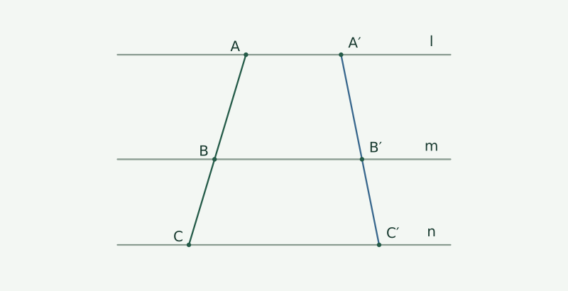

<figcaption><strong>Figura 3.</strong> Tres paralelas y dos transversales. Al mover la paralela intermedia cambian las razones, pero permanecen iguales entre sí.</figcaption>
</figure>

### Teorema fundamental

**Teorema 3.2.4.** Bajo las condiciones no degeneradas de 3.2.1,

$$\triangle ABC\sim\triangle ADE.$$

*Demostración.* Primero supongamos $D$ entre $A,B$. Los ángulos correspondientes son iguales por el paralelismo. Del lema,

$$\frac{DB}{AD}=\frac{EC}{AE}
\quad\Longrightarrow\quad
\frac{AD+DB}{AD}=\frac{AE+EC}{AE},$$

por lo que $AB/AD=AC/AE$. Por $E$, tracemos $EF\parallel AB$, con $F\in BC$. El mismo argumento da $AC/AE=BC/BF$. Como $BDEF$ es un paralelogramo, $BF=DE$, y así

$$\frac{AB}{AD}=\frac{AC}{AE}=\frac{BC}{DE}.$$

Si $D$ está más allá de $B$, se aplica el caso interior al triángulo mayor $ADE$. Si está más allá de $A$, se comparan ángulos opuestos por el vértice y ángulos entre paralelas; las áreas del lema dan las mismas proporciones, sustituyendo las sumas por las diferencias de segmentos que correspondan. También se puede trasladar el triángulo opuesto mediante una media vuelta alrededor de $A$ para reducirlo al caso de las mismas semirrectas.

**Congruencia y semejanza.** Ambas son relaciones de equivalencia: son reflexivas, simétricas y transitivas. Para la semejanza, la reflexividad usa el factor $1$; la simetría invierte $k$; la transitividad multiplica los factores. Por ejemplo, si $ABC\sim DEF$ y $DEF\sim GHI$, entonces $ABC\sim GHI$, manteniendo las correspondencias.

## 3.3 Otros criterios de semejanza

No es necesario comprobar por separado los tres ángulos y las tres razones de lados.

**Teorema 3.3.1. Criterio AAA.** Dos triángulos son semejantes si y solo si sus tres ángulos correspondientes son congruentes.

*Demostración.* La necesidad es parte de la definición. Para la suficiencia, situamos una copia congruente de un triángulo de modo que comparta un ángulo con el otro y sus lados adyacentes queden sobre las mismas semirrectas. La igualdad de otro par de ángulos hace paralelos los terceros lados. Se aplica 3.2.4; si los terceros lados coinciden, los triángulos son congruentes.

**Ejercicio 3.3.2.** Muestre que la igualdad de todos los ángulos correspondientes de dos cuadriláteros no garantiza su semejanza. Véase 3.7.

**Teorema 3.3.3. Criterio sAs.** Si

$$\frac{AB}{DE}=\frac{AC}{DF},\qquad \angle BAC=\angle EDF,$$

entonces $\triangle ABC\sim\triangle DEF$. El ángulo debe ser el **comprendido** entre los dos lados comparados.

**Teorema 3.3.4. Criterio sss.** Dos triángulos son semejantes si y solo si

$$\frac{AB}{DE}=\frac{BC}{EF}=\frac{AC}{DF}.$$

En las abreviaturas del libro, la $s$ minúscula recuerda que los lados son proporcionales, mientras que la $A$ mayúscula indica igualdad de ángulos. No deben confundirse sAs y sss con los criterios de congruencia SAS y SSS.

**Teorema 3.3.5. Criterio AA.** Dos triángulos son semejantes si y solo si dos pares de ángulos correspondientes son congruentes. Esto equivale a AAA porque la suma de los ángulos de cada triángulo es $180^\circ$.

**Lema 3.3.6. Recíproco de 3.2.1, en el caso interior.** Si $P$ está entre $A,B$, $Q$ entre $A,C$, y

$$\frac{AP}{PB}=\frac{AQ}{QC},$$

entonces $PQ\parallel BC$.

*Demostración.* Por $P$, tracemos $PR\parallel BC$ con $R\in AC$. El lema 3.2.1 da $AP/PB=AR/RC$, así que $AR/RC=AQ/QC$. Para una razón positiva $k$, solo hay un punto interior $X$ de $AC$ con $AX/XC=k$: necesariamente $AX=k\,AC/(1+k)$. Por ello $R=Q$.

*Demostración de sAs.* Sea $k=AB/DE=AC/DF$. Si $k=1$, se aplica SAS. Si $k<1$, intercambiamos los triángulos; podemos suponer $k>1$. Tomemos $P\in AB$, $Q\in AC$ con $AP=DE$, $AQ=DF$. Como $AB/AP=AC/AQ$, restar $1$ e invertir da $AP/PB=AQ/QC$. Por 3.3.6, $PQ\parallel BC$, y por 3.2.4, $ABC\sim APQ$. Además, $APQ\cong DEF$ por SAS. La transitividad concluye la prueba.

**Ejercicio 3.3.7.** Demuestre el criterio sss. La solución aparece en 3.7.

<figure class="geometry-figure" id="geometry3-fig-4" data-geometry3="criteria">

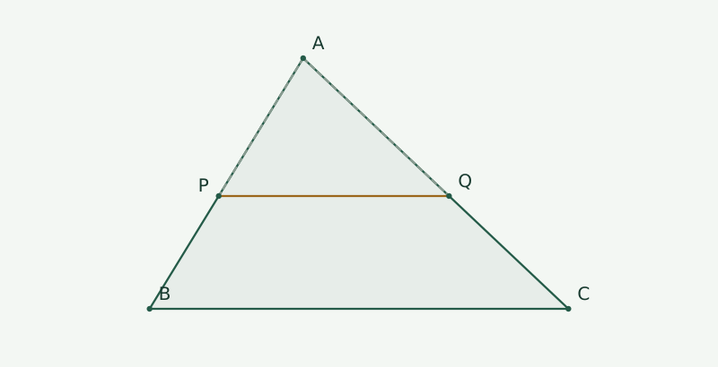

<figcaption><strong>Figura 4.</strong> Construcción auxiliar para sAs y sss: APQ es una copia a escala de ABC y PQ es paralelo a BC.</figcaption>
</figure>

## 3.4 Ejemplos

### Teorema de Pitágoras

**Teorema 3.4.1.** Si un triángulo rectángulo tiene catetos de longitudes $a,b$ e hipotenusa $c$, entonces $a^2+b^2=c^2$.

*Demostración por semejanza.* En $ABC$, rectángulo en $C$, usemos $a=BC$, $b=AC$, $c=AB$. Sea $D$ el pie de la altura desde $C$ sobre $AB$, y pongamos $AD=p$, $DB=q$. Por AA,

$$\triangle CBD\sim\triangle ABC,\qquad
\triangle ACD\sim\triangle ABC.$$

Las correspondencias dan $a/c=q/a$ y $b/c=p/b$. Por tanto,

$$a^2=cq,\qquad b^2=cp,\qquad
 a^2+b^2=c(p+q)=c^2.$$

<figure class="geometry-figure" id="geometry3-fig-5" data-geometry3="pythagoras">

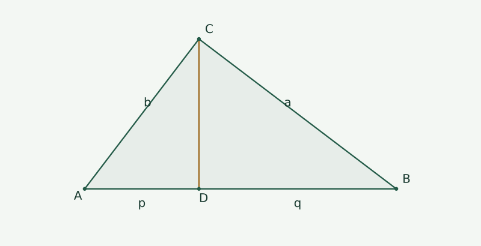

<figcaption><strong>Figura 5.</strong> La altura sobre la hipotenusa produce dos triángulos semejantes al original. Se mantienen a²=cq y b²=cp.</figcaption>
</figure>

**Teorema 3.4.2. Recíproco.** Si $AB^2=BC^2+CA^2$, entonces $\angle C$ es recto.

**Ejercicio 3.4.3.** Demuestre 3.4.2. Véase 3.7.

### Teorema de Apolonio y longitud de una mediana

**Teorema 3.4.4.** Si $M$ es el punto medio de $BC$, entonces

$$AB^2+AC^2=2AM^2+2BM^2.$$

*Demostración.* Sea $AD\perp\overleftrightarrow{BC}$. Si $D$ está entre $M,C$, Pitágoras da

$$\begin{aligned}
AB^2+AC^2
&=(BM+MD)^2+(BM-MD)^2+2AD^2\\
&=2BM^2+2MD^2+2AD^2\\
&=2BM^2+2AM^2.
\end{aligned}$$

Si $D$ está en otra posición, las expresiones para $BD,CD$ cambian entre sumas y diferencias; al elevarlas al cuadrado y sumarlas, se obtiene el mismo resultado. Si $D=M$, la identidad se sigue directamente de los dos triángulos rectángulos.

**Ejemplo 3.4.5.** Para $a=BC$, $b=AC$, $c=AB$ y $m_a=AM$,

$$m_a=\frac12\sqrt{2b^2+2c^2-a^2}.$$

En efecto, $b^2+c^2=2m_a^2+a^2/2$ por Apolonio. Se despeja $m_a^2$ y se toma la raíz positiva.

<figure class="geometry-figure" id="geometry3-fig-6" data-geometry3="apollonius">

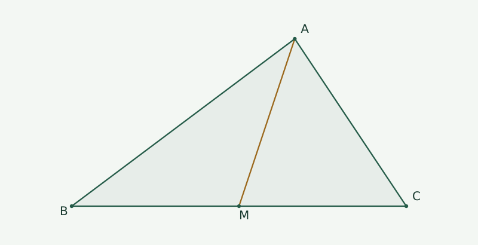

<figcaption><strong>Figura 6.</strong> Apolonio relaciona los lados con la mediana AM. Se puede cambiar la posición de A, incluso cuando el pie de altura queda fuera de BC.</figcaption>
</figure>

### Teorema de Stewart

**Teorema 3.4.6.** Sea $D$ interior a $BC$, y sean

$$d=AD,\quad m=BD,\quad n=DC,\quad b=AC,\quad c=AB,\quad a=BC=m+n.$$

Entonces

$$c^2n+b^2m=a(d^2+mn).$$

*Demostración.* Sea $E$ el pie de la perpendicular desde $A$ a $BC$, con $h=AE$, $k=DE$. En la configuración del libro, $E$ está entre $B,D$. Por Pitágoras,

$$d^2=h^2+k^2,\quad
c^2=(m-k)^2+h^2=m^2-2mk+d^2,$$
$$b^2=(n+k)^2+h^2=n^2+2nk+d^2.$$

Multiplicamos la expresión de $c^2$ por $n$ y la de $b^2$ por $m$ y sumamos. Se cancelan los términos $2mnk$, dando

$$nc^2+mb^2=mn(m+n)+(m+n)d^2=a(mn+d^2).$$

Si $E$ queda al otro lado de $D$, cambian a la vez los signos de los dos términos cruzados, que siguen cancelándose; si $E=D$, basta tomar $k=0$. La identidad vale para cualquier forma no degenerada del triángulo.

<figure class="geometry-figure" id="geometry3-fig-7" data-geometry3="stewart">

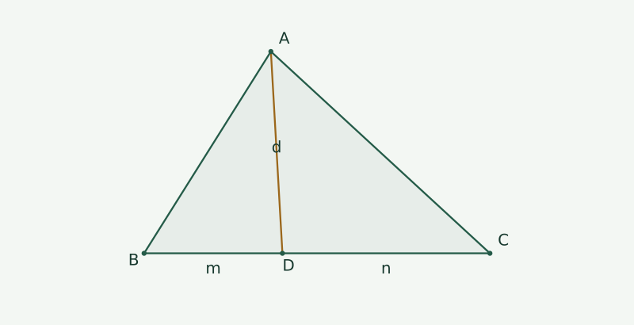

<figcaption><strong>Figura 7.</strong> Al deslizar D por BC, las dos expresiones de Stewart coinciden. m y n son longitudes positivas.</figcaption>
</figure>

### Bisectrices interiores y exteriores

**Teorema 3.4.7. Teorema de la bisectriz.**

1. Si $AD$ es la bisectriz interior de $\angle BAC$, con $D\in BC$, entonces $AB/AC=DB/DC$.
2. Si la bisectriz exterior en $A$ corta $\overleftrightarrow{BC}$ en $D$, entonces también $AB/AC=DB/DC$, usando longitudes positivas. En este caso $D$ está **fuera** del segmento $BC$.

**Precisión.** Si $AB=AC$, la bisectriz exterior es paralela a $BC$ y no existe ese punto de intersección finito. No se debe colocar $D$ dentro del lado en el segundo enunciado.

*Demostración del caso interior.* Por $C$ trazamos $CE\parallel AD$, con $E$ en la prolongación de $BA$ más allá de $A$. Los ángulos de la bisectriz y el paralelismo dan $\angle AEC=\angle ACE$, luego $AE=AC$. Además, $ABD\sim EBC$, de donde $AB/EB=BD/BC$. Restando las longitudes correspondientes, o dividiendo ambas razones por sus complementarias,

$$\frac{AB}{EB-AB}=\frac{BD}{BC-BD},$$

es decir, $AB/AE=BD/DC=AB/AC$. El caso exterior se demuestra con una paralela análoga y queda como ejercicio, como en el libro.

<figure class="geometry-figure" id="geometry3-fig-8" data-geometry3="bisectors">

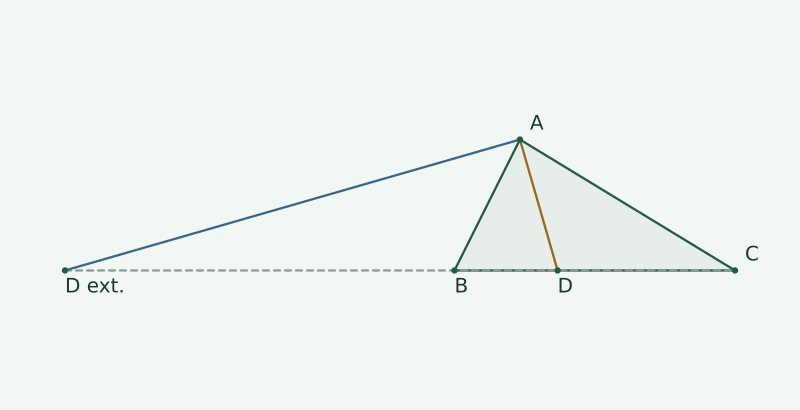

<figcaption><strong>Figura 8.</strong> La bisectriz interior divide BC en la razón AB:AC. La exterior divide la recta en esa misma razón, fuera del segmento.</figcaption>
</figure>

**Ejemplo 3.4.8.** Sea $AD=\ell_A$ la longitud de la bisectriz interior. Entonces

$$\ell_A^2=bc\left[1-\left(\frac{a}{b+c}\right)^2\right].$$

*Solución.* Con $m=BD$, $n=DC$, el teorema anterior da $m/n=c/b$. Puesto que $m+n=a$,

$$m=\frac{ac}{b+c},\qquad n=\frac{ab}{b+c}.$$

Stewart da $c^2n+b^2m=a(\ell_A^2+mn)$. El miembro izquierdo es $abc$; al dividir por $a$,

$$bc=\ell_A^2+\frac{a^2bc}{(b+c)^2},$$

que es la fórmula buscada.

**Corolario 3.4.9.** Las otras dos expresiones se obtienen por permutación cíclica:

$$\begin{aligned}
\ell_A^2&=bc\left[1-\left(\frac{a}{b+c}\right)^2\right],\\
\ell_B^2&=ac\left[1-\left(\frac{b}{a+c}\right)^2\right],\\
\ell_C^2&=ab\left[1-\left(\frac{c}{a+b}\right)^2\right].
\end{aligned}$$

**Ejercicio 3.4.10.** Si $AD,BE,CF$ son las bisectrices interiores desde $A,B,C$ y $\angle BAC<\angle ABC<\angle ACB$, demuestre que $AD>BE>CF$. Se precisa la referencia al ángulo en $C$: es $\angle ACB$. La escritura $\angle ACE$ que aparece en el enunciado del libro no corresponde a ese ángulo, pues $E$ pertenece a $AC$.

### Medianas y concurrencia

**Ejemplo 3.4.11.** Sean $BE,CF$ medianas que se cortan en $G$. Entonces

$$\frac{EG}{GB}=\frac{FG}{GC}=\frac12,$$

y las tres medianas concurren en $G$.

*Solución.* Como $F,E$ son puntos medios de $AB,AC$, por sAs $AFE\sim ABC$, con factor $1/2$. Por ello $FE\parallel BC$ y $FE=BC/2$. Los ángulos entre paralelas y los opuestos por el vértice dan

$$\triangle EFG\sim\triangle BCG.$$

Así, $EG/BG=FG/CG=EF/BC=1/2$. Si $AD$ es la tercera mediana y corta $BE$ en $H$, el mismo argumento da $EH/HB=1/2$. Como hay un único punto interior de $BE$ con esa razón, $H=G$.

**Precisión de correspondencia.** El factor $1/2$ corresponde al orden *triángulo pequeño / triángulo grande*. En particular, se escribe $AFE\sim ABC$ y $EFG\sim BCG$; invertir el orden exige usar factor $2$.

<figure class="geometry-figure" id="geometry3-fig-9" data-geometry3="medians">

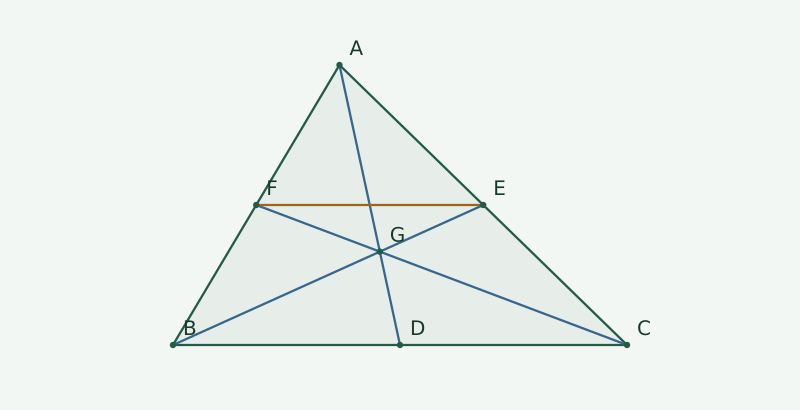

<figcaption><strong>Figura 9.</strong> La paralela FE permite demostrar por semejanza la división 2:1 de cada mediana.</figcaption>
</figure>

**Teorema 3.4.12.** Sean $D\in\overleftrightarrow{AB}$, $E\in\overleftrightarrow{AC}$, con $DE\parallel BC$, en una configuración no degenerada. Sean $P$ interior a $BC$ y $Q$ interior a $DE$. Entonces

$$A,P,Q\text{ son colineales}\quad\Longleftrightarrow\quad
\frac{BP}{PC}=\frac{DQ}{QE}.$$

*Demostración.* Si son colineales, $APB\sim AQD$ y $APC\sim AQE$. Por tanto, $BP/DQ=AP/AQ=PC/QE$, y reordenar da la razón del enunciado. Recíprocamente, sea $Q'$ la intersección de $AP$ con $DE$. El caso directo da $DQ'/Q'E=BP/PC=DQ/QE$. La unicidad de la división interior en una razón positiva implica $Q'=Q$. El argumento vale también para las configuraciones de paralelas exteriores.

<figure class="geometry-figure" id="geometry3-fig-10" data-geometry3="collinearity">

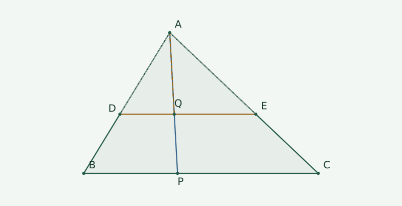

<figcaption><strong>Figura 10.</strong> La igualdad de las razones de división caracteriza la alineación de A, P y Q.</figcaption>
</figure>

## 3.5 Problemas de construcción

La estrategia consiste en construir primero una figura semejante, con tamaño conveniente, y después ajustarla mediante paralelas. Las construcciones básicas de perpendiculares, paralelas, mediatrices y bisectrices son las de los capítulos anteriores.

### División de segmentos

**Ejemplo 3.5.1. Dividir $PQ$ en tres partes iguales.**

1. Desde $P$, trace una semirrecta distinta de $PQ$.
2. Con una misma abertura del compás, marque $R',S',Q'$ con $PR'=R'S'=S'Q'$.
3. Una $Q'$ con $Q$.
4. Por $R',S'$, trace paralelas a $Q'Q$; sus intersecciones con $PQ$ son $R,S$.

Por 3.2.3, $PR=RS=SQ$. La elección de la semirrecta y de la abertura del compás no cambia los puntos finales $R,S$.

La misma construcción divide $AB$ en una razón dada $p:q$, con $p,q>0$: en una semirrecta auxiliar se marcan consecutivamente longitudes $p,q$ y se proyecta paralelamente el punto de separación. Se obtiene $AC/CB=p/q$.

<figure class="geometry-figure" id="geometry3-fig-11" data-geometry3="division">

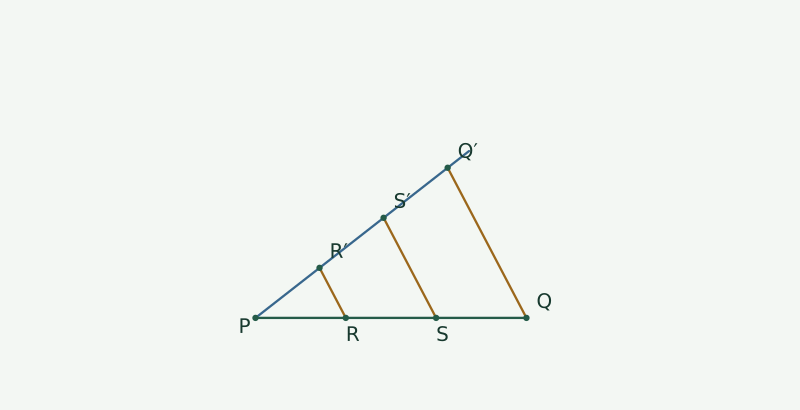

<figcaption><strong>Figura 11.</strong> Construcción por pasos de la trisección de PQ mediante una semirrecta auxiliar y paralelas.</figcaption>
</figure>

### Una transversal con una razón prescrita

**Ejemplo 3.5.2.** Dadas $l\parallel m$, $A\in l$, $B\in m$ y $P$ entre las paralelas, construir una recta por $P$ que las corte en $C,D$ con $AC=BD/2$.

**Primera construcción.** Prolongue $BA$ más allá de $A$ hasta $Q$, con $AQ=AB$. Trace $QP$ y tome $C=QP\cap l$, $D=QP\cap m$. Como $QA/QB=1/2$, los triángulos con vértice $Q$ dan $AC/BD=1/2$ cuando esos segmentos no son nulos. Si $P\in AB$, la recta $AB$ satisface la igualdad $AC=BD/2=0$.

**Segunda construcción del libro.** Sobre $l$ marque $AE$; sobre $m$, en el mismo sentido, marque $BF,FG$ con $AE=BF=FG$. La intersección de $AB$ y $EG$ es $Q$. La semejanza da $QA/QB=AE/BG=1/2$. La recta $QP$ produce la misma razón requerida. Estas construcciones proporcionan una solución; el enunciado no exige enumerar todas las posibles transversales.

<figure class="geometry-figure" id="geometry3-fig-12" data-geometry3="transversal">

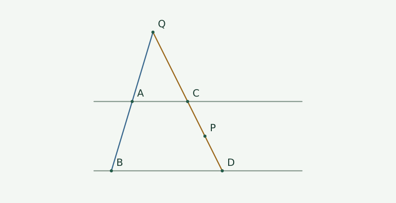

<figcaption><strong>Figura 12.</strong> La posición de Q fija la razón 1:2 entre los segmentos de las dos paralelas.</figcaption>
</figure>

### Circunferencias tangentes a los lados de un ángulo

**Ejemplo 3.5.3.** Dado $P$ estrictamente dentro de un ángulo $A$ de medida entre $0^\circ$ y $180^\circ$, construir las dos circunferencias que pasan por $P$ y son tangentes a sus lados.

1. Trace la bisectriz interior $AB$ y elija $O'\ne A$ sobre ella.
2. Baje $O'Q'$ perpendicular a un lado y dibuje $C(O',O'Q')$. Es tangente a ambos lados.
3. La semirrecta $AP$ corta esta circunferencia en dos puntos distintos $P',P''$.
4. Por $P$ trace una paralela a $P'Q'$ hasta cortar el lado $AQ'$ en $Q$. La perpendicular al lado por $Q$ corta la bisectriz en $O$.
5. Dibuje $C(O,OQ)$.
6. Repita usando $P''Q'$: obtenga $Q''$, luego $O''$ y finalmente $C(O'',O''Q'')$.

*Justificación.* Las paralelas dan $OQ/O'Q'=AQ/AQ'=QP/Q'P'$. Además, los ángulos comprendidos correspondientes son iguales. Por sAs, $OQP\sim O'Q'P'$. Como $O'P'=O'Q'$, resulta $OP=OQ$; la circunferencia pasa por $P$. Su centro está en la bisectriz y su radio es perpendicular a un lado, por lo que es tangente a ambos. El mismo argumento funciona con $P''$. Como la dirección $AP$ está estrictamente dentro del ángulo, es secante a toda circunferencia auxiliar inscrita en él y produce dos escalas positivas distintas.

<figure class="geometry-figure" id="geometry3-fig-13" data-geometry3="anglecircles">

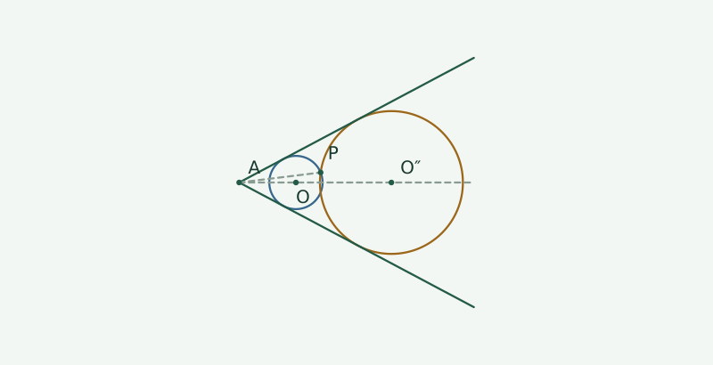

<figcaption><strong>Figura 13.</strong> Las dos circunferencias solución pasan por P y son tangentes a los dos lados del ángulo.</figcaption>
</figure>

**Homotecia.** Esta construcción utiliza una transformación $H(A,k)$, llamada **homotecia de centro $A$ y razón $k\ne0$**. El punto imagen $Q$ de $P$ está en la recta $AP$ y satisface $AQ=|k|\,AP$: en la misma semirrecta si $k>0$, y en la opuesta si $k<0$. El centro queda fijo. Esta precisión de semirrecta es necesaria: una igualdad entre longitudes positivas no define por sí sola una razón negativa. El libro ilustra $H(A,3)$.

<figure class="geometry-figure" id="geometry3-fig-14" data-geometry3="homothety">

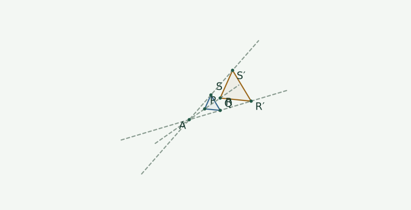

<figcaption><strong>Figura 14.</strong> H(A,k): el signo de k determina la semirrecta y su valor absoluto determina la escala.</figcaption>
</figure>

### Construcciones por traslación

**Ejemplo 3.5.4.** Dados $l$ y dos puntos distintos $P,Q$ del mismo lado de $l$, con $PQ\perp l$, construir una circunferencia tangente a $l$ que pase por ambos.

1. Construya la mediatriz $m$ de $PQ$; es paralela a $l$.
2. Elija $O'\in m$, baje $O'T'\perp l$ y ponga $r=O'T'$. Dibuje $C(O',r)$.
3. La paralela a $l$ por $P$ corta esa circunferencia en dos puntos posibles $P'$.
4. Para cada elección, traslade $O'$ por el desplazamiento de $P'$ a $P$, obteniendo $O$. Equivalentemente, marque $O$ sobre $m$ con $O'O=P'P$, eligiendo **el sentido que lleva $P'$ a $P$**.
5. Dibuje $C(O,r)$.

*Justificación.* La traslación lleva $P'$ a $P$, por lo que $OP=r$. Como $O$ permanece en la mediatriz de $PQ$, $OQ=OP$. Al desplazarse el centro paralelamente a $l$, su distancia a $l$ sigue siendo $r$. Las dos intersecciones de la etapa 3 producen las dos soluciones. Elegir solo una distancia $O'O$, sin fijar el sentido, no basta para justificar la construcción.

<figure class="geometry-figure" id="geometry3-fig-15" data-geometry3="translation">

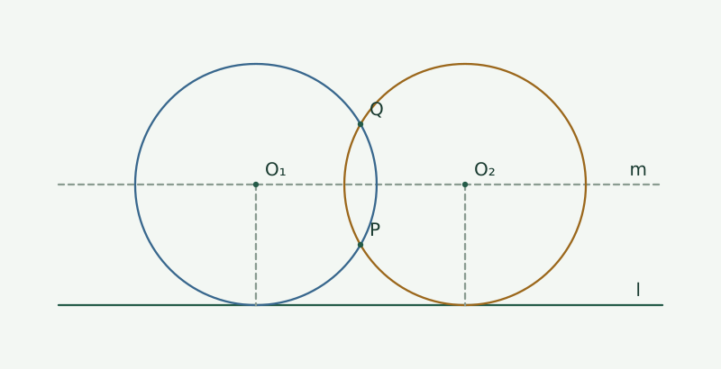

<figcaption><strong>Figura 15.</strong> Dos circunferencias tangentes a l pasan por P y Q. Sus centros están en la mediatriz m de PQ.</figcaption>
</figure>

**Ejemplo 3.5.5. Tangentes comunes a dos circunferencias.** Sean $C(O,R)$ y $C(Q,r)$ exteriormente separadas: $OQ>R+r$. En la construcción siguiente suponemos $R>r$.

Para construir las dos tangentes **exteriores**:

1. Construya el radio $R-r$: sobre un radio $OA=R$ marque $AB=r$ hacia el centro, de modo que $OB=R-r$.
2. Dibuje $C(O,R-r)$ y trace desde $Q$ sus tangentes $QS,QT$.
3. Prolongue $OS,OT$ hasta cortar $C(O,R)$ en $P,W$.
4. Trace por $P$ una paralela a $QS$ y por $W$ una paralela a $QT$.

*Justificación.* Construya $U$ de modo que $QSPU$ sea un rectángulo. Entonces $QU=SP=r$, y $PU\perp QU$; por tanto, $PU$ es tangente a la circunferencia menor. También $PU\perp OP$, así que es tangente a la mayor. La segunda recta se justifica igual. Si $R=r$, las tangentes exteriores son las dos paralelas a $OQ$ a distancia $R$; la circunferencia auxiliar de radio cero no debe usarse. Las dos tangentes **interiores** se dejan para el problema 9.

<figure class="geometry-figure" id="geometry3-fig-16" data-geometry3="tangents">

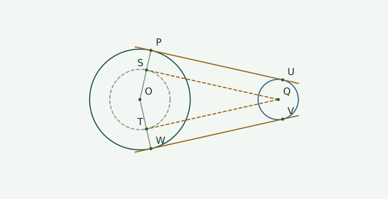

<figcaption><strong>Figura 16.</strong> Construcción de las tangentes exteriores usando la circunferencia auxiliar de radio R−r.</figcaption>
</figure>

## 3.6 Potencia de un punto

El capítulo presenta un problema de un nenúfar: una hoja flota a $50$ cm de la vertical de su raíz, con el tallo tenso; al levantarla verticalmente sobre la raíz, llega a $10$ cm por encima del agua. Se pide la profundidad. Volveremos a él después de estudiar los productos de secantes.

### Secantes, cuerdas y tangentes

**Teorema 3.6.1.** Sean dos rectas por $P$ que cortan una circunferencia $\omega$ en $A,B$ y $C,D$, respectivamente. Con longitudes no dirigidas,

$$PA\cdot PB=PC\cdot PD.$$

*Demostración exterior.* Suponga $P,A,B$ en ese orden y $P,C,D$ en ese orden. Dibuje $AD$ y $BC$. Los ángulos inscritos que interceptan el mismo arco y el ángulo común en $P$ dan $PAD\sim PCB$. Por ello $PA/PC=PD/PB$, y se obtiene la igualdad.

*Demostración interior.* Si $P$ está dentro, $PDA\sim PBC$: un par de ángulos es opuesto por el vértice y otro intercepta el mismo arco. Entonces $PD/PB=PA/PC$, que da el mismo producto. Si $P$ está en la circunferencia, ambos productos son cero.

<figure class="geometry-figure" id="geometry3-fig-17" data-geometry3="secants">

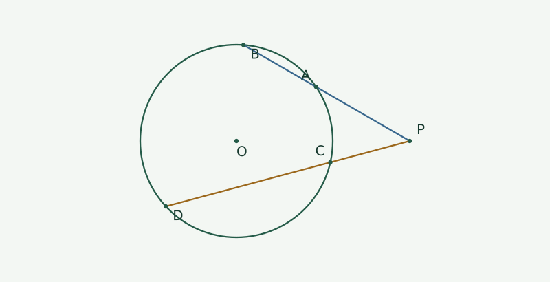

<figcaption><strong>Figura 17.</strong> Dos secantes por P: los productos de longitudes coinciden tanto en el caso exterior como en el interior.</figcaption>
</figure>

**Teorema 3.6.2.** Si $P$ es exterior y $PT$ es tangente en $T$, entonces, para cualquier secante $PAB$,

$$PT^2=PA\cdot PB.$$

*Demostración.* Dibuje $TA,TB$. El teorema del ángulo entre tangente y cuerda da $\angle PTA=\angle PBT$, y el ángulo en $P$ es común. Así, $PTA\sim PBT$ y $PT/PB=PA/PT$. No es necesario recurrir a un argumento de límite.

<figure class="geometry-figure" id="geometry3-fig-18" data-geometry3="tangentpower">

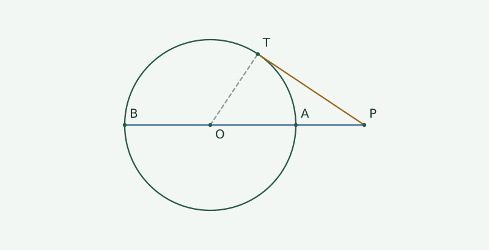

<figcaption><strong>Figura 18.</strong> El cuadrado de la longitud de la tangente es igual al producto de la secante.</figcaption>
</figure>

**Teorema 3.6.3.** Si $P$ es interior y es punto medio de una cuerda $TS$, para cualquier otra cuerda $AB$ por $P$,

$$PT^2=PA\cdot PB.$$

*Demostración.* Por 3.6.1, $PA\,PB=PT\,PS$, y $PT=PS$. Esa cuerda $TS$ es perpendicular a $OP$ si $P\ne O$; si $P=O$, cualquier diámetro sirve. No existe una tangente desde un punto interior.

### Distancias dirigidas y signo de la potencia

Fije un sentido positivo en una recta. La **distancia dirigida** de $A$ a $B$ se escribe $\overline{AB}$ y vale $AB$ si $B$ está después de $A$, $-AB$ si está antes, y $0$ si coinciden. En particular, $\overline{BA}=-\overline{AB}$. Esta barra denota aquí un número con signo, no la longitud de un segmento.

**Teorema 3.6.4.** Para una recta secante por $P$, el producto

$$\overline{PA}\,\overline{PB}$$

es independiente de la secante elegida. Es positivo si $P$ es exterior, cero si está en $\omega$ y negativo si es interior. Se llama **potencia de $P$ respecto de $\omega$**.

*Justificación.* En el exterior las dos distancias dirigidas tienen el mismo signo; en el interior tienen signos opuestos. Sus valores absolutos satisfacen 3.6.1. Cambiar la orientación de una recta cambia ambos signos y conserva el producto. Para una tangente exterior se interpreta $A=B=T$ y el producto es $PT^2$.

**Corolario 3.6.5.** Si $\omega=C(O,r)$, entonces

$$\operatorname{Pot}_{\omega}(P)=OP^2-r^2.$$

*Demostración.* Elija la secante que pasa por $O$. Orientada de $P$ hacia $O$, sus intersecciones tienen distancias dirigidas $OP-r$ y $OP+r$, cuyo producto es $OP^2-r^2$. Si $P=O$, cualquier diámetro da $(-r)r=-r^2$.

**Atención al signo.** Dentro de la circunferencia, $PA\,PB=r^2-OP^2$ con longitudes positivas, pero la potencia es $OP^2-r^2<0$. El valor positivo del teorema 3.6.3 no es la potencia dirigida.

<figure class="geometry-figure" id="geometry3-fig-19" data-geometry3="power">

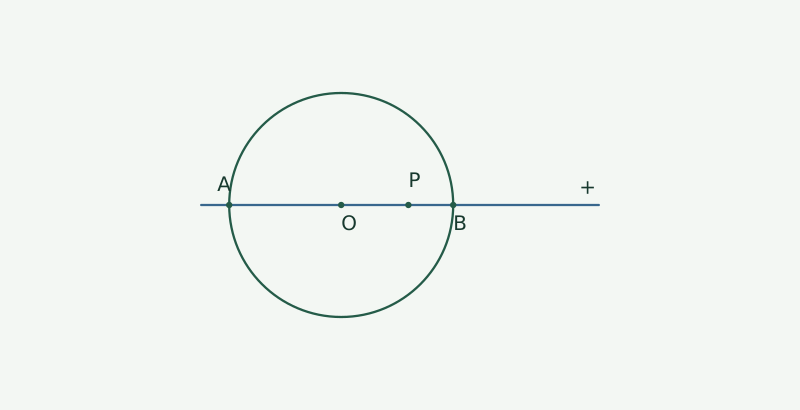

<figcaption><strong>Figura 19.</strong> La potencia cambia de signo al cruzar la circunferencia. Las distancias dirigidas se miden sobre una misma recta orientada.</figcaption>
</figure>

### El nenúfar y el horizonte

**Problema del nenúfar.** Sea $O$ la raíz, $P$ el punto de la superficie justo encima de ella y $OP=x$ la profundidad. El tallo tiene longitud $x+10$, de modo que sus posiciones extremas están sobre una circunferencia de centro $O$ y radio $x+10$. La horizontal del agua corta esa circunferencia en dos puntos a $50$ cm de $P$. La vertical la corta a distancias $10$ y $2x+10$ desde $P$, en sentidos opuestos. Por 3.6.1 o 3.6.3,

$$10(2x+10)=50^2,$$

por lo que $20x+100=2500$ y **la profundidad es $120$ cm**. El tallo mide $130$ cm. Aquí $P$ es interior: se usan productos de longitudes positivas de cuerdas, no una tangente desde $P$.

<figure class="geometry-figure" id="geometry3-fig-20" data-geometry3="lily">

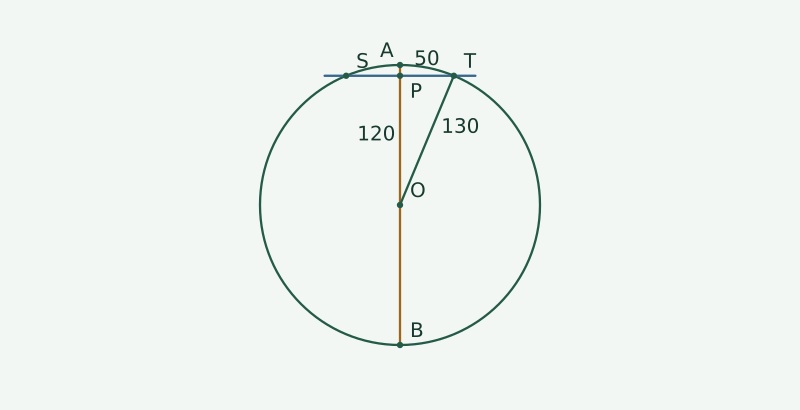

<figcaption><strong>Figura 20.</strong> Configuración del nenúfar: 120 cm de profundidad, 130 cm de tallo y 50 cm de desplazamiento horizontal.</figcaption>
</figure>

**Ejemplo 3.6.6. Estimación del diámetro terrestre.** Un observador tiene sus ojos a $1$ km sobre el nivel del mar y el horizonte está a $113$ km de sus ojos. En el modelo esférico del problema, la visual es tangente a la Tierra. Si $x$ es su diámetro, una secante por el centro tiene tramos desde el observador de longitudes $1$ y $x+1$. Por 3.6.2,

$$1(x+1)=113^2,\qquad x=12768\ \mathrm{km}.$$

Es una estimación geométrica con los datos del ejercicio; el esquema no está a escala.

<figure class="geometry-figure" id="geometry3-fig-21" data-geometry3="horizon">

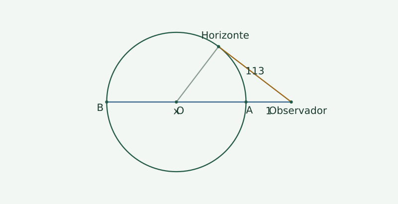

<figcaption><strong>Figura 21.</strong> La visual al horizonte es tangente. La secante radial tiene longitudes 1 y x+1. Esquema no dibujado a escala.</figcaption>
</figure>

## 3.7 Soluciones de los ejercicios

### Solución del ejercicio 3.3.2

Dos rectángulos tienen los cuatro ángulos iguales, pero no siempre son semejantes. Por ejemplo, un rectángulo de lados $2,1$ y otro de lados $3,1$ no tienen lados correspondientes proporcionales: $2/3\ne1/1$. Así, AAA no se extiende a cuadriláteros.

<figure class="geometry-figure" id="geometry3-fig-22" data-geometry3="rectangles">

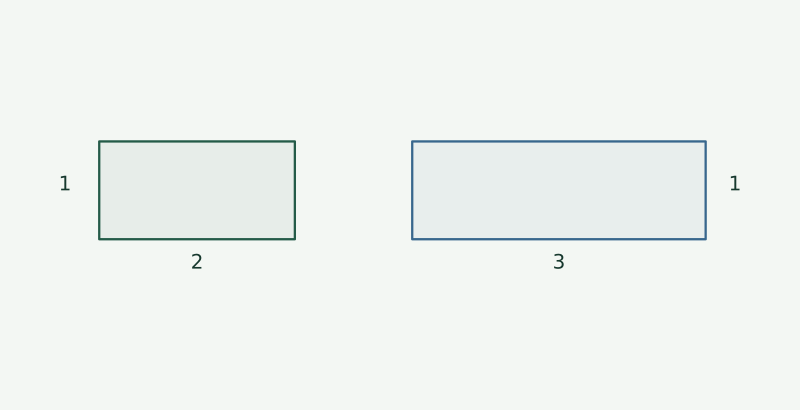

<figcaption><strong>Figura 22.</strong> La igualdad de ángulos no basta para la semejanza de cuadriláteros.</figcaption>
</figure>

### Solución del ejercicio 3.3.7

Suponga $AB/DE=BC/EF=AC/DF=k$. Si $k=1$, SSS da congruencia. Intercambiando los triángulos si hace falta, podemos suponer $0<k<1$.

Sobre $ED$ marque $P$ con $EP=AB$, y por $P$ trace $PQ\parallel DF$, con $Q\in EF$. Por 3.2.4,

$$\frac{EQ}{EF}=\frac{EP}{ED}=k=\frac{BC}{EF},\qquad
\frac{PQ}{DF}=k=\frac{AC}{DF}.$$

Luego $EQ=BC$, $PQ=AC$ y $EP=BA$. Por SSS, $EPQ\cong BAC$. Los ángulos de $EPQ$, junto con $PQ\parallel DF$, identifican los tres pares de ángulos de $ABC,DEF$. Por tanto, son semejantes.

### Solución del ejercicio 3.4.3

Construya $PQR$ rectángulo en $R$, con $QR=BC$, $RP=CA$. Por Pitágoras,

$$PQ^2=QR^2+RP^2=BC^2+CA^2=AB^2.$$

Como las longitudes son positivas, $PQ=AB$. SSS da $ABC\cong PQR$, con $C\leftrightarrow R$, y así $\angle C=90^\circ$.

### Solución del ejercicio 3.4.10

Basta comparar las bisectrices desde dos vértices cualesquiera. Suponga $\angle B<\angle C$, y escriba $\beta=\angle CBE=B/2$, $\gamma=\angle BCF=C/2$, de modo que $0<\beta<\gamma$. Sea $G\in BE$ tal que $\angle FCG=\beta$, eligiendo el rayo $CG$ entre $CF$ y $CA$. Ese rayo corta el segmento $BE$ antes de $E$.

Los ángulos $\angle FBG$ y $\angle FCG$ son iguales a $\beta$; sus vértices están del mismo lado de $FG$. El recíproco del teorema del ángulo inscrito sitúa $F,G,B,C$ en una misma circunferencia. Además,

$$\angle CBF=2\beta<\beta+\gamma=\angle BCG<90^\circ,$$

porque $\beta+\gamma=(B+C)/2<90^\circ$. En esa circunferencia, la cuerda $CF$ corresponde al menor de esos ángulos inscritos agudos, mientras que $BG$ corresponde al mayor. Por la comparación de cuerdas (equivalentemente, por los ángulos centrales y la desigualdad SAS), $CF<BG$. Como $G$ es interior a $BE$, $BG<BE$. Así, $CF<BE$.

Aplicando la misma comparación a $A<B<C$, se obtiene $AD>BE>CF$. Si dos ángulos son iguales, la simetría del triángulo isósceles da igualdad de las bisectrices correspondientes. En esta prueba, los símbolos $A,B,C$ dentro de expresiones angulares representan sus medidas.

<figure class="geometry-figure" id="geometry3-fig-23" data-geometry3="bisectororder">

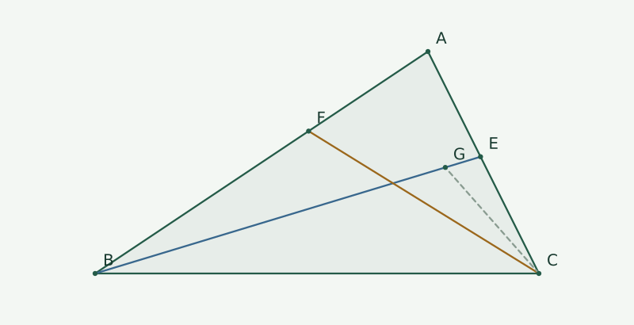

<figcaption><strong>Figura 23.</strong> Construcción auxiliar de la comparación de bisectrices: G pertenece a BE y F, G, B, C son concíclicos.</figcaption>
</figure>

## 3.8 Problemas

Se conserva la numeración del libro. Los problemas se proponen para resolver; las figuras permiten explorar sus configuraciones sin sustituir la demostración.

1. En $\triangle ABC$, sean $P,Q\in BC$ con $BP=PQ=QC$. La paralela a $AC$ por $P$ corta $AB$ en $X$, y la paralela a $AB$ por $Q$ corta $AC$ en $Y$. Pruebe que $ABC\sim AXY$.

2. Las alturas $BE,CF$ se cortan en $H$. Pruebe que $BH\cdot HE=CH\cdot HF$. Las longitudes son no dirigidas; se consideran las rectas de las alturas cuando el triángulo es obtusángulo.

3. En el triángulo isósceles $ABC$, $AD$ es altura, $AB=\tfrac32 BC$, $AF=4FD$ y $FD=1$. Sea $FE$ perpendicular a $AC$, con $E\in AC$. Halle $FE$.

<figure class="geometry-figure" id="geometry3-fig-24" data-geometry3="problem3">

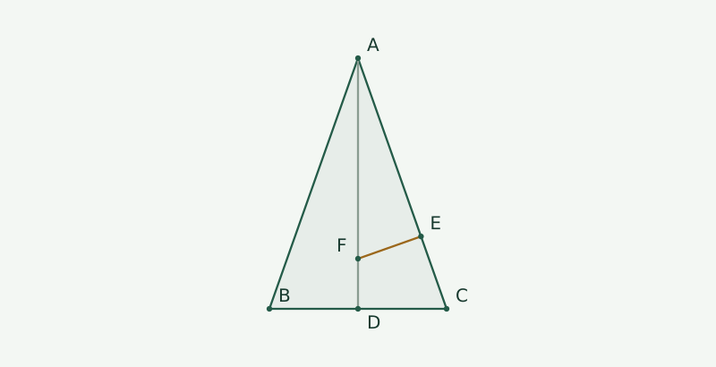

<figcaption><strong>Figura 24.</strong> Problema 3: se conservan AB=(3/2)BC, AF=4FD y FD=1.</figcaption>
</figure>

4. Sea $AB=AC$ y $D$ el punto medio de $BC$. Tome $K\ne C$ en la paralela a $AB$ por $C$. La recta $KD$ corta las rectas $AB,AC$ en $P,Q$, respectivamente. Pruebe que $AP\cdot QK=BP\cdot QP$. Se requiere que esas intersecciones sean finitas y estén definidas; las prolongaciones están permitidas.

5. La bisectriz interior de $\angle BAC$ corta $BC$ en $D$. La circunferencia de centro $C$ que pasa por $D$ corta nuevamente la recta $AD$ en $X$. Pruebe que $AB\cdot AX=AC\cdot AD$. Para dos intersecciones distintas se supone $AB\ne AC$; si $AB=AC$, la recta es tangente en $D$ y la igualdad se interpreta con $X=D$.

6. **Teorema de los ojos (Eyeball Theorem).** Sean $P,Q$ los centros de dos circunferencias exteriormente separadas. Desde $Q$, trace las dos tangentes a la circunferencia de centro $P$; sus segmentos cortan la circunferencia de centro $Q$ en los puntos próximos al otro centro $C,D$. Desde $P$, trace las tangentes a la circunferencia de centro $Q$; los segmentos cortan la circunferencia de centro $P$ en los puntos próximos al otro centro $A,B$. Pruebe que las cuerdas $AB$ y $CD$ tienen igual longitud. Esta descripción explicita qué intersecciones señala la figura del libro.

<figure class="geometry-figure" id="geometry3-fig-25" data-geometry3="eyeball">

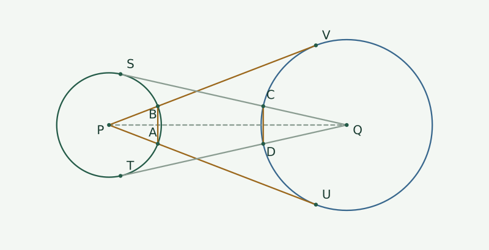

<figcaption><strong>Figura 25.</strong> Problema 6: A y B están en la circunferencia de centro P; C y D, en la de centro Q. Las rectas que los determinan son tangentes a la otra circunferencia.</figcaption>
</figure>

7. Dado $ABC$ con ángulos $B,C$ agudos, construya un cuadrado $PQRS$ con $PQ\subset BC$, $R\in AB$ y $S\in AC$.

<figure class="geometry-figure" id="geometry3-fig-26" data-geometry3="square">

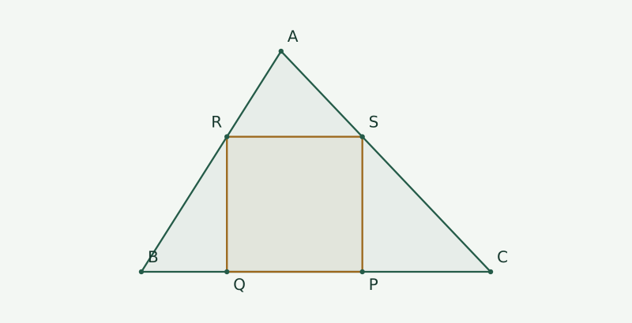

<figcaption><strong>Figura 26.</strong> Problema 7: el cuadrado inscrito mantiene sus cuatro lados iguales al cambiar la forma del triángulo.</figcaption>
</figure>

8. Dados una recta $l$ y dos puntos distintos $P,Q$ del mismo lado de $l$, con $PQ$ no paralelo a $l$, construya una circunferencia tangente a $l$ que pase por $P,Q$.

9. Dadas $C(O,R)$ y $C(Q,r)$, con $R>r$ y $OQ>R+r$, construya las dos tangentes comunes **interiores**, que cruzan el segmento entre los centros.

10. Construya $ABC$ conociendo la longitud de $BC$ y las longitudes $m_B,m_C$ de las medianas desde $B,C$. Discuta cuándo los datos permiten un triángulo no degenerado.

11. En la configuración del dibujo, $P,C$ son centros de las circunferencias. El punto $A$ pertenece a ambas y $P,A,B$ están alineados, con $B$ sobre la circunferencia de centro $C$. Si $PA=3$, $BC=4$ y $PC=6$, halle $AB$.

<figure class="geometry-figure" id="geometry3-fig-27" data-geometry3="problem11">

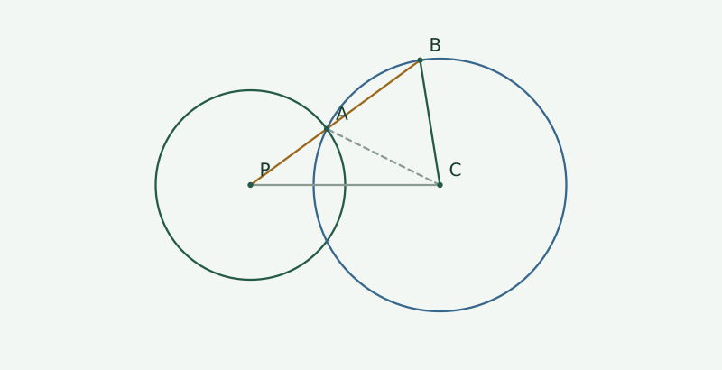

<figcaption><strong>Figura 27.</strong> Problema 11: P, A, B son colineales; PA=3, CA=CB=4 y PC=6.</figcaption>
</figure>

12. Para una circunferencia de radio $1$, determine todos los puntos de potencia $3$ respecto de ella.

13. Una recta $l$ corta $\omega$ en $A,B$, con $AB=3$. Construya todos los puntos de $l$ cuya potencia respecto de $\omega$ sea $4$.

<figure class="geometry-figure" id="geometry3-fig-28" data-geometry3="problem13">

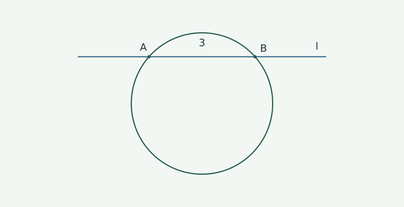

<figcaption><strong>Figura 28.</strong> Problema 13: la cuerda AB mide 3; se buscan puntos sobre toda la recta l.</figcaption>
</figure>

14. Pruebe el siguiente recíproco parcial de 3.6.4, usando distancias dirigidas. Sean $l\ne m$ rectas que se cortan en $P$; sean $A,B\in l$ y $C,D\in m$, cuatro puntos distintos entre sí y diferentes de $P$. Si $\overline{PA}\,\overline{PB}=\overline{PC}\,\overline{PD}$, pruebe que $A,B,C,D$ son concíclicos. Las condiciones de distinción evitan configuraciones degeneradas que no forman un cuadrilátero.

15. Dos circunferencias distintas se cortan en $A,B$. Determine todos los puntos con la misma potencia respecto de ambas circunferencias.

16. **Teorema de la mariposa (Butterfly Theorem).** Sea $M$ el punto medio de la cuerda $PQ$. Otras dos cuerdas $AB,CD$ pasan por $M$. Las rectas $AD,BC$ cortan $PQ$ en $X,Y$, respectivamente, en la configuración del dibujo, con intersecciones definidas. Pruebe que $MX=MY$. **Sugerencia del libro:** trace perpendiculares desde $X,Y$ a $AB,CD$ y busque cuatro pares de triángulos semejantes.

<figure class="geometry-figure" id="geometry3-fig-29" data-geometry3="butterfly">

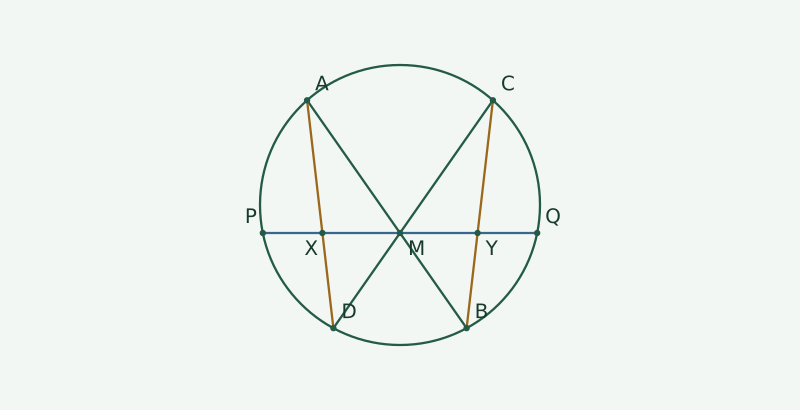

<figcaption><strong>Figura 29.</strong> Problema 16: M es el punto medio de PQ y las dos cuerdas auxiliares pasan por M. La igualdad MX=MY persiste al moverlas dentro de la configuración.</figcaption>
</figure>

## Referencia del capítulo

I. E. Leonard, J. E. Lewis, A. C. F. Liu y G. W. Tokarsky. *Classical Geometry: Euclidean, Transformational, Inversive, and Projective*. Wiley, 2014. Capítulo 3, «Similarity», pp. 59–93. Estas notas emplean los resultados anteriores como antecedentes; no desarrollan los teoremas de Ceva y Menelao ni otros temas de capítulos posteriores.
