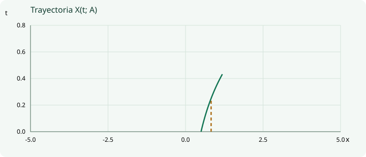
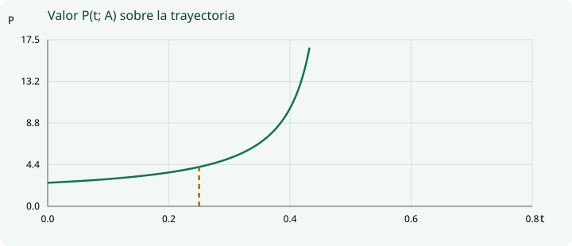
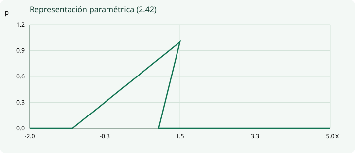
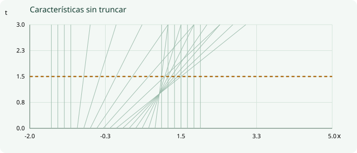
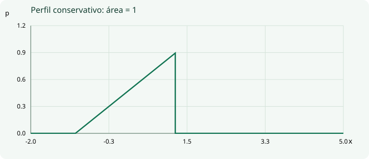
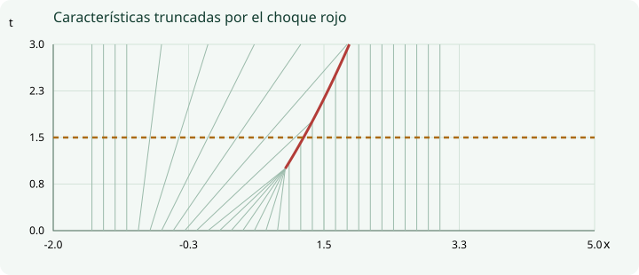

## Introducción: del individuo al continuo

En el capítulo anterior, las variables dependían principalmente del tiempo. Ahora una propiedad también puede variar con la posición: escribimos $\rho(x,t)$ o, en varias dimensiones, $\rho(\mathbf x,t)$. El objetivo es describir cómo se redistribuye una cantidad cuando hay movimiento, producción o pérdida.

La **hipótesis del continuo** reemplaza el seguimiento de individuos por campos promediados sobre regiones pequeñas. La densidad $f(x,t)$ representa cantidad por unidad de longitud, área o volumen, según el modelo. Su integral es una cantidad total:

$$F(t)=\int f(x,t)\,dx.$$

La variable espacial puede representar una posición física, pero también edad, tamaño u otra característica de una población. Por ello, las ecuaciones de transporte aparecen en fluidos, sólidos, poblaciones estructuradas y otros sistemas.

Estas notas desarrollan, con redacción propia, el capítulo 2 de Witelski y Bowen (2015), pp. 23–45. Las secciones 2.1–2.6 contienen la teoría; 2.7 orienta lecturas y 2.8 organiza los ejercicios del libro. Se mantienen las variables y la numeración de las ecuaciones citadas del libro. Las figuras interactivas corresponden a sus ejemplos de características y de Burgers. Se supone suficiente regularidad cuando se derivan identidades punto a punto; al aparecer choques se vuelve a la formulación integral.

## 2.1. Teorema de transporte de Reynolds

### Dos descripciones del movimiento

Una **descripción euleriana** especifica campos en posiciones fijas, por ejemplo la velocidad $\mathbf v(\mathbf x,t)$. Una **descripción lagrangiana** sigue una partícula etiquetada por su posición inicial $\mathbf A$. Su trayectoria satisface

$$\frac{d\mathbf X}{dt}=\mathbf v(\mathbf X(t;\mathbf A),t),\qquad \mathbf X(0;\mathbf A)=\mathbf A.$$

Si $f(\mathbf x,t)$ es una propiedad, su valor sobre esa trayectoria es $F(t;\mathbf A)=f(\mathbf X(t;\mathbf A),t)$ (2.4). La velocidad lagrangiana es $\mathbf V(t;\mathbf A)=\mathbf v(\mathbf X(t;\mathbf A),t)$ (2.2). La regla de la cadena da

$$\frac{df_{\mathrm{part}}}{dt}=\frac{\partial f}{\partial t}+\mathbf v\cdot\nabla f\equiv\frac{Df}{Dt}.\tag{2.5}$$

Aquí $f_{\mathrm{part}}(t)\equiv F(t;\mathbf A)$.

El operador $D/Dt$ es la **derivada material o convectiva**. En una dimensión es $\partial_t+v\partial_x$. No se confunde con $\partial_t$: esta última observa un lugar fijo, mientras que la derivada material acompaña una partícula.

Si la velocidad está prescrita, estudiamos un problema cinemático. Si depende de las propiedades que buscamos y debe determinarse con ellas, el problema es dinámico. En el transporte pasivo, la sustancia transportada no modifica el campo de velocidad.

### Un intervalo que se mueve con el flujo

El libro denota por $f_{\mathrm{blob}}$ la cantidad acumulada sobre un dominio material:

$$f_{\mathrm{blob}}(t)=\iiint_{D(t)}f(\mathbf x,t)\,dV,\tag{2.6}$$

y, en una dimensión,

$$f_{\mathrm{blob}}(t)=\int_{a(t)}^{b(t)}f(x,t)\,dx.\tag{2.7}$$

Sea $[a(t),b(t)]$ un intervalo material: $a'=v(a,t)$ y $b'=v(b,t)$. Por la regla de Leibniz,

$$\begin{aligned}
\frac{d}{dt}\int_{a(t)}^{b(t)} f(x,t)\,dx
&=\int_a^b f_t\,dx+f(b,t)b'-f(a,t)a'\\
&=\int_a^b\left[f_t+(fv)_x\right]\,dx.
\end{aligned}\tag{2.8}$$

Los términos de los extremos contabilizan el movimiento del intervalo. Omitirlos equivale a tratar como fijo un dominio que no lo es.

### Forma multidimensional

Para un dominio material $D(t)$ cuya frontera se mueve con $\mathbf v$, el **teorema de transporte de Reynolds** establece

$$\boxed{\frac{d}{dt}\int_{D(t)} f\,dV=\int_{D(t)}\bigl[\partial_t f+\nabla\cdot(f\mathbf v)\bigr]\,dV.}\tag{2.9}$$

Equivalentemente, el integrando es $Df/Dt+f\nabla\cdot\mathbf v$. El segundo término mide el efecto de la expansión o contracción del volumen. El teorema también se obtiene sumando la variación local y el flujo debido a la frontera móvil, y aplicando el teorema de la divergencia.

## 2.2. Deducción de leyes de conservación

### De una identidad integral a una ecuación local

Si una función continua $g$ tiene integral cero en **todo** subintervalo, entonces $g=0$. En efecto, si $g(x_0)>0$, la continuidad proporciona un intervalo donde $g>0$, cuya integral sería positiva; el caso negativo es análogo. La condición «todo subdominio» es esencial.

Supongamos que la masa de cada dominio material permanece constante. Reynolds implica

$$0=\int_{D(t)}\bigl[\rho_t+\nabla\cdot(\rho\mathbf v)\bigr]\,dV.$$

Como vale para cualquier dominio material, obtenemos la **ecuación de continuidad**:

$$\boxed{\rho_t+\nabla\cdot(\rho\mathbf v)=0.}\tag{2.13}$$

En una dimensión, $\rho_t+(\rho v)_x=0$. El flujo es $q=\rho v$: cantidad que cruza una sección por unidad de tiempo. En varias dimensiones, $\rho\mathbf v\cdot\mathbf n$ es el flujo normal por unidad de área, con $\mathbf n$ normal exterior.

Expandiendo la divergencia,

$$\frac{D\rho}{Dt}=-\rho\nabla\cdot\mathbf v.$$

**Conservar masa no significa conservar densidad sobre una trayectoria.** Si el volumen se expande, la densidad disminuye. En particular, para un flujo sin divergencia y sin fuentes se obtiene $D\rho/Dt=0$.

### Fuentes y sumideros

Sea $R$ la producción neta por unidad de volumen y tiempo. Si

$$\frac{d}{dt}\int_{D(t)}\rho\,dV=\int_{D(t)}R\,dV,$$

entonces

$$\rho_t+\nabla\cdot(\rho\mathbf v)=R,\qquad \frac{D\rho}{Dt}=R-\rho\nabla\cdot\mathbf v.$$

En un intervalo **fijo** $[a,b]$, el balance es

$$\frac{d}{dt}\int_a^b\rho\,dx=q(a,t)-q(b,t)+\int_a^b R\,dx.$$

Así, el total cambia por entrada menos salida, más producción interna.

### Conservación del momento

El momento por unidad de volumen es $\rho\mathbf v$. Aplicar Reynolds componente a componente y la segunda ley de Newton conduce a

$$\frac{\partial(\rho\mathbf v)}{\partial t}+\nabla\cdot(\rho\mathbf v\mathbf v)=\nabla\cdot\boldsymbol\sigma.\tag{2.18}$$

Aquí $\boldsymbol\sigma$ es el tensor de esfuerzos; $\mathbf v\mathbf v$ es el producto diádico, con componentes $v_i v_j$. El libro escribe la fuerza por unidad de volumen como $\mathbf f=\nabla\cdot\boldsymbol\sigma$. Esta expresión considera fuerzas representadas por esfuerzos, como en el capítulo. Junto con continuidad, equivale a $\rho D\mathbf v/Dt=\nabla\cdot\boldsymbol\sigma$. Para cerrar un modelo deben especificarse relaciones constitutivas que expresen los esfuerzos en función de las variables del sistema.

## 2.3. Ecuación de advección lineal

Sin fuentes y con velocidad constante $c$, la continuidad se reduce a

$$\rho_t+c\rho_x=0,\qquad \rho(x,0)=P(x),\quad x\in\mathbb R.$$

La solución es

$$\boxed{\rho(x,t)=P(x-ct).}\tag{2.20}$$

Para verificarlo, $\rho_t=-cP'(x-ct)$ y $\rho_x=P'(x-ct)$. El perfil se traslada sin deformarse: hacia la derecha si $c>0$, hacia la izquierda si $c<0$, y permanece fijo si $c=0$. Cada característica es $x=A+ct$ y transporta el valor $P(A)$.

### Modos de Fourier y relación de dispersión

El libro escribe el perfil mediante su serie compleja de Fourier, $P(x)=\sum_k A_ke^{ikx}$. Así, la onda viajera se expresa como

$$\rho(x,t)=\sum_{k=-\infty}^{\infty}A_ke^{ik(x-ct)}=\sum_{k=-\infty}^{\infty}A_ke^{i[kx-\omega t]}.\tag{2.21}$$

Para un modo

$$\rho_k(x,t)=A_k e^{i(kx-\omega t)},$$

$k$ es el número de onda, $\omega$ la frecuencia angular, y $\omega=\omega(k)$ la **relación de dispersión**. Para un modo oscilatorio real con $k\ne0$, la longitud de onda se denota $L$ y el período $T$. El libro escribe $L=2\pi/k$ y $T=2\pi/\omega$, tomando números de onda y frecuencias positivos para estas magnitudes. Se toma la parte real para representar una magnitud real.

Al sustituir en advección resulta $\omega=ck$. La velocidad de fase $c_p=\omega/k$ es la misma para todos los modos: no hay dispersión.

En cambio, para

$$\rho_t+c_1\rho_x+c_3\rho_{xxx}+c_5\rho_{xxxxx}=0,\tag{2.22}$$

la sustitución produce

$$-i\omega+ic_1k-ic_3k^3+ic_5k^5=0,$$

por lo que $\omega=c_1k-c_3k^3+c_5k^5$ y $c_p=c_1-c_3k^2+c_5k^4$. Al propagarse los modos con velocidades distintas, su suma cambia de forma.

El libro también considera la difusión $\rho_t=\rho_{xx}$. Sustituir el mismo modo da $\omega=-ik^2$, de manera que

$$\rho_k(x,t)=(A_k e^{-k^2t})e^{ikx}.$$

La amplitud decae y no hay propagación de fase. Así se distingue este comportamiento de la dispersión, donde los modos pueden conservar amplitud y desplazarse a velocidades diferentes.

## 2.4. Sistemas de advección lineal

El libro considera dos propiedades $p(x,t)$ y $q(x,t)$ sobre $-\infty<x<\infty$, con coeficientes constantes:

$$p_t+ap_x+bq_x=0,\tag{2.23a}$$
$$q_t+cp_x+dq_x=0,\tag{2.23b}$$
$$p(x,0)=f(x),\qquad q(x,0)=g(x).\tag{2.23c}$$

Buscamos una variable que obedezca una ecuación de advección independiente:

$$w_t+\lambda w_x=0\quad\Longrightarrow\quad w(x,t)=W(x-\lambda t).\tag{2.24}$$

Para ello se propone la combinación

$$w(x,t)=Ap(x,t)+Bq(x,t),\tag{2.25}$$

con $A,B$ constantes por determinar. Multiplicar (2.23a) por $A$ y (2.23b) por $B$ y sumar produce

$$(Ap+Bq)_t+(aA+cB)p_x+(bA+dB)q_x=0.$$

Comparar con $w_t+\lambda w_x=0$ da

$$\begin{pmatrix}a&c\\b&d\end{pmatrix}\begin{pmatrix}A\\B\end{pmatrix}=\lambda\begin{pmatrix}A\\B\end{pmatrix}.\tag{2.26}$$

Los valores propios determinan las velocidades. Dos vectores propios independientes dan las relaciones

$$\begin{aligned}
w_1(x,t)&=A_1p(x,t)+B_1q(x,t)=W_1(x-\lambda_1t),\\
w_2(x,t)&=A_2p(x,t)+B_2q(x,t)=W_2(x-\lambda_2t).
\end{aligned}\tag{2.27}$$

Las condiciones iniciales fijan los perfiles:

$$A_1f(x)+B_1g(x)=W_1(x),\qquad A_2f(x)+B_2g(x)=W_2(x).\tag{2.28}$$

Conocidos los lados derechos de (2.27), se resuelve ese sistema algebraico para recuperar $p$ y $q$.

Para $n$ ecuaciones, el libro utiliza $\mathbf p=(p,q,r,\ldots)^T$:

$$\frac{\partial\mathbf p}{\partial t}+M\frac{\partial\mathbf p}{\partial x}=0.\tag{2.29}$$

Se propone $w=\mathbf u\cdot\mathbf p$, con $\mathbf u=(A,B,C,\ldots)^T$, y se obtiene

$$M^T\mathbf u=\lambda\mathbf u.\tag{2.30}$$

Si todos los valores propios son reales y existe una base completa de vectores propios, el sistema se denomina **hiperbólico**, en el sentido utilizado en el capítulo. Entonces sus soluciones se expresan mediante sumas de ondas viajeras. Los símbolos $A,B$ de esta sección son coeficientes de una combinación lineal; en la sección siguiente, $A$ vuelve a representar la posición inicial de una característica.

## 2.5. Método de las características

Una ecuación semilineal de primer orden tiene la forma

$$p_t+c(x,t)p_x=r(x,t,p),\qquad p(x,0)=f(x).$$

La velocidad no depende de $p$, aunque la reacción sí puede hacerlo. Definimos $P(t;A)=p(X(t;A),t)$. La regla de la cadena convierte la EDP en el sistema

$$\boxed{X'=c(X,t),\quad P'=r(X,t,P),\quad X(0;A)=A,\quad P(0;A)=f(A).}$$

El procedimiento consiste en resolver $X$, resolver después $P$ y, si es posible, invertir $x=X(t;A)$ para recuperar la etiqueta $A=A(x,t)$. Finalmente, $p(x,t)=P(t;A(x,t))$.

### Ejemplo del capítulo

Para

$$p_t+2xp_x=xp^2,\qquad p(x,0)=2+\sin x,\tag{2.35}$$

las características satisfacen $X'=2X$, de modo que $X=Ae^{2t}$. Entonces

$$P'=Ae^{2t}P^2,\qquad \frac{d}{dt}\left(\frac1P\right)=-Ae^{2t}.$$

Integrando y usando el dato inicial,

$$P(t;A)=\left[\frac{1}{2+\sin A}-\frac A2(e^{2t}-1)\right]^{-1}.$$

Como $A=xe^{-2t}$, obtenemos

$$\boxed{p(x,t)=\left[\frac{1}{2+\sin(xe^{-2t})}+\frac x2(e^{-2t}-1)\right]^{-1}.}$$

La expresión representa la solución del problema inicial en el intervalo conectado con $t=0$ donde el denominador permanece distinto de cero. No se prolonga a través de un denominador nulo. En la figura, el control de tiempo se limita al intervalo anterior a esa singularidad.

<figure class="transport-figure">

Activa JavaScript para utilizar los controles.

<figcaption>Trayectoria y valor de la solución sobre una característica seleccionada. La visualización no prolonga la fórmula a través de una explosión.</figcaption></figure>

## 2.6. Choques en ecuaciones cuasilineales

### Cuando la velocidad depende de la solución

Para $p_t+c(x,t,p)p_x=r(x,t,p)$, las ecuaciones características son $X'=c(X,t,P)$ y $P'=r(X,t,P)$. Ahora están acopladas. Dos características con valores distintos pueden alcanzar el mismo punto: la representación paramétrica deja de definir una función univaluada.

La ecuación de Burgers sin viscosidad es

$$p_t+pp_x=0,\qquad p(x,0)=f(x).$$

Sus características satisfacen

$$P(t;A)=f(A),\qquad X(t;A)=A+tf(A).$$

### Pulso triangular del capítulo

Consideremos $f(A)=\max(1-|A|,0)$. Las cuatro ramas características son

$$\begin{cases}
X=A,\quad P=0,&A<-1,\\
X=(1+A)t+A,\quad P=1+A,&-1\le A\le0,\\
X=(1-A)t+A,\quad P=1-A,&0\le A\le1,\\
X=A,\quad P=0,&A>1.
\end{cases}\tag{2.42}$$

Para $0\le t<1$,

$$p(x,t)=\begin{cases}
0,&x<-1,\\
\dfrac{1+x}{1+t},&-1\le x\le t,\\
\dfrac{1-x}{1-t},&t<x\le1,\\
0,&x>1.
\end{cases}\tag{2.43}$$

La rama izquierda se expande; la derecha se comprime. El perfil es continuo y suave por tramos, no globalmente diferenciable en sus esquinas. En $t=1$, todas las características de $0\le A\le1$ alcanzan $x=1$. Prolongarlas más allá produciría valores múltiples. La solución física se construye con un salto móvil o **choque**.

<figure class="transport-figure">

Activa JavaScript para utilizar los controles.

<figcaption>Ejemplo (2.40)–(2.43): características y representación paramétrica del pulso triangular. Después de t = 1, las ramas superpuestas todavía no constituyen una solución univaluada.</figcaption></figure>

### Balance integral y condición de Rankine–Hugoniot

Escribamos la ley conservativa como $p_t+\partial_x q(p)=0$. En un intervalo fijo,

$$\frac{d}{dt}\int_a^b p\,dx=q(p(a,t))-q(p(b,t)).$$

Sea $x_s(t)$ la posición de un salto, con valores laterales $p_-$ a la izquierda y $p_+$ a la derecha. Dividimos la integral en $[a,x_s(t)]$ y $[x_s(t),b]$. Leibniz aporta el término $x_s'(p_--p_+)$; los flujos interiores aportan $q(p_+)-q(p_-)$. Su suma debe ser cero, y resulta

$$\frac{dx_s}{dt}=\frac{q(p_+(x_s,t))-q(p_-(x_s,t))}{p_+(x_s,t)-p_-(x_s,t)}.\tag{2.48}$$

Se supone que los estados laterales son distintos.

Esta condición expresa conservación a través del salto y determina su velocidad una vez conocidos los estados laterales.

Para Burgers, $q(p)=p^2/2$, así que

$$\boxed{x_s'=\frac{p_-+p_+}{2}.}$$

**Nota de revisión del texto.** En la primera igualdad de (2.49), p. 37, el libro imprime una diferencia entre los estados. La factorización en (2.48) da la suma $(p_++p_-)/2$, coherente con la segunda igualdad de (2.49). Aquí se conserva la notación y se corrige explícitamente ese signo.

### Solución después del choque

En el pulso triangular, $p_-=(1+x_s)/(1+t)$ y $p_+=0$. Por tanto,

$$x_s'=\frac{1+x_s}{2(1+t)},\qquad x_s(1)=1.$$

Separando variables, $\log(1+x_s)=\tfrac12\log(1+t)+C$. La condición inicial fija la constante y obtenemos

$$x_s(t)=\sqrt{2(1+t)}-1,\qquad t\ge1.$$

La solución conservativa para $t\ge1$ es

$$p(x,t)=\begin{cases}\dfrac{1+x}{1+t},&-1\le x<x_s(t),\\0,&x<-1\ \text{o}\ x>x_s(t).\end{cases}$$

El valor asignado exactamente en el salto no altera las integrales. La altura izquierda es $p_- =\sqrt{2/(1+t)}$. El área se conserva:

$$\int_{\mathbb R}p(x,t)\,dx=\frac12\underbrace{\sqrt{2(1+t)}}_{\text{base}}\underbrace{\sqrt{2/(1+t)}}_{\text{altura}}=1.$$

La construcción elimina las ramas superpuestas respetando el balance de área. Esta selección también se describe en el libro como regla de áreas iguales.

<figure class="transport-figure">

Activa JavaScript para utilizar los controles.

<figcaption>Formación del choque en el pulso triangular. El perfil conserva área uno antes y después del tiempo crítico t = 1; la curva roja representa el choque.</figcaption></figure>

## 2.7. Para continuar la lectura

El capítulo remite a textos sobre ondas lineales y no lineales y a tratamientos de EDP que desarrollan las características. Antes de avanzar, conviene poder distinguir: descripción euleriana y lagrangiana; derivada parcial y material; advección y conservación con velocidad variable; dispersión y disipación; solución clásica y solución con choque.

**Referencia principal:** T. Witelski y M. Bowen, *Methods of Mathematical Modelling: Continuous Systems and Differential Equations*, Springer, 2015, capítulo 2, «Transport Equations», pp. 23–45. Estas notas son material de apoyo y deben utilizarse junto con el libro y las indicaciones de clase.

## 2.8. Ejercicios

Los ejercicios siguientes corresponden a los problemas 2.1–2.15 del capítulo. Se conservan sus datos y notación, con enunciados reformulados en español. No se añaden problemas externos ni soluciones a esta sección.

### 2.1. Promedio sobre un intervalo material

Los extremos $a(t)$ y $b(t)$ se mueven según $dx/dt=v(x,t)$. Para

$$f_{\mathrm{avg}}(t)=\frac{1}{b(t)-a(t)}\int_{a(t)}^{b(t)}f(x,t)\,dx,$$

calcular $\lim_{b\to a}df_{\mathrm{avg}}/dt$. Utilizar $b(t)=a(t)+\varepsilon h(t)$ con $\varepsilon\to0$.

### 2.2. Momento de un gas compresible

Partiendo de

$$\rho_t+(\rho v)_x=0,\qquad \rho(v_t+vv_x)=-P_x,$$

demostrar la equivalencia de la segunda ecuación con

$$(\rho v)_t+(\rho v^2)_x=-P_x.$$

Aquí $P(x,t)$ es la presión y $\rho Dv/Dt$ expresa la aceleración material multiplicada por la densidad.

### 2.3. Velocidades de fase y de grupo

Considerar

$$\rho(x,t)=\cos(kx-\omega(k)t)+\cos([k+\varepsilon]x-\omega(k+\varepsilon)t).$$

(a) Para $\varepsilon\to0$, reescribir la suma en la forma

$$\rho(x,t)=2\cos(k[x-c_p(k)t])\cos\!\left(\tfrac12\varepsilon[x-c_g(k)t]\right)+O(\varepsilon),$$

e identificar la velocidad de grupo $c_g$.

(b) Para

$$\rho_t+\rho_x-\rho_{xxt}=0,\tag{2.51}$$

obtener la relación de dispersión mediante $\rho=\cos(kx-\omega t)$ y calcular $c_g$. Determinar también la relación modificada $\widetilde\omega(k)$ utilizando $\rho=e^{kx-\widetilde\omega t}$.

### 2.4. Ondas solitarias

Para la ecuación de Benjamin–Bona–Mahony,

$$\rho_t+\rho_x+6\rho\rho_x-\rho_{xxt}=0,$$

(a) introducir $\rho(x,t)=P(x-ct)$ y obtener la EDO para $P(s)$, con $s=x-ct$;

(b) buscar una familia $P(s)=A\operatorname{sech}^2(Bs)$ y relacionar $A,B$ con $c$;

(c) comprobar la relación entre esta onda y la relación de dispersión modificada del ejercicio 2.3.

### 2.5. Ondas de agua

El potencial $\phi(x,y,t)$ y el perfil $f(x,t)$ satisfacen

$$\begin{aligned}
\phi_{xx}+\phi_{yy}&=0&&0\le y\le1,\\
\phi_y&=0&&y=0,\\
\phi_t+f&=0&&y=1,\\
f_t&=\phi_y&&y=1.
\end{aligned}$$

Suponiendo $f(x,t)=A\cos(kx-\omega t)$, mostrar que el potencial tiene la forma $\phi(x,y,t)=B(y)\sin(kx-\omega t)$ y obtener $\omega(k)$.

**Nota de lectura:** la descripción verbal del libro menciona la superficie en $y=0$, pero sus dos condiciones de superficie se imponen en $y=1$. Se mantienen aquí las condiciones matemáticas del enunciado.

### 2.6. Problemas de transporte

Obtener soluciones explícitas $\rho(x,t)$ para $t\ge0$:

(a) Sobre $-\infty<x<\infty$,

$$\rho_t+e^{2t}\rho_x=\rho+x+t,\qquad \rho(x,0)=\cos x.$$

(b) Sobre $x\ge0$,

$$\rho_t+(x+4)\rho_x=-2\rho,\qquad \rho(0,t)=\cos t,\qquad \rho(x,0)=e^{-x}.$$

El segundo problema incluye una señal prescrita en la frontera.

### 2.7. Una porción de fluido compresible

En $t=0$, una porción de fluido tiene densidad uniforme $\rho=1$ sobre $1\le x\le2$. Su velocidad es $v(x,t)=x^2e^{-3t}$ y satisface

$$\rho_t+(\rho v)_x=0.$$

(a) Hallar $\rho(x,t)$; (b) determinar los extremos $x_1(t)$ y $x_2(t)$; (c) evaluar directamente $\int_{x_1(t)}^{x_2(t)}\rho(x,t)\,dx$ y comprobar su consistencia con Reynolds.

### 2.8. Características en dos dimensiones

Una sustancia radiactiva tiene concentración inicial

$$c_0(x,y)=\begin{cases}1-(x^2+y^2),&x^2+y^2\le1,\\0,&\text{en otro caso}.\end{cases}$$

Sin flujo, decaería según $dc/dt=-c$. Se transporta por $\mathbf v=(1+x,y)$.

(a) A partir del balance material

$$\frac{d}{dt}\iint_{D(t)}c\,dA=-\iint_{D(t)}c\,dA,$$

deducir la EDP para $c$.

(b) Parametrizar los datos iniciales mediante coordenadas materiales polares $(R,\Theta)$ y resolver las ecuaciones características para $X,Y,C$.

(c) Recuperar $c(x,y,t)$; (d) hallar el centro y el radio de la frontera circular del soporte en cada instante.

### 2.9. Sistema de ondas

Para

$$p_t+5p_x-7q_x=0,\qquad q_t+2p_x-4q_x=0,$$

(a) determinar valores y vectores propios que describen las ondas viajeras;

(b) hallar $p(x,t)$ y $q(x,t)$ con datos

$$p(x,0)=5\sin(7x),\qquad q(x,0)=-9\cos(4x).$$

### 2.10. Ecuación clásica de ondas

Considerar

$$\frac{\partial^2\phi}{\partial t^2}=c^2\frac{\partial^2\phi}{\partial x^2},\tag{2.52}$$

con $\phi(x,0)=f(x)$ y $\phi_t(x,0)=g(x)$.

(a) Introducir $q=\phi_x$ y $p=\phi_t$ para obtener $p_t-c^2q_x=0$, $q_t-p_x=0$.

(b) Resolver para $p,q$ mediante ondas viajeras.

(c) Reconstruir $\phi(x,t)=A(x-ct)+B(x+ct)$.

(d) Determinar las funciones $A,B$ a partir de $f,g$. El resultado es la solución de D'Alembert.

### 2.11. Aguas poco profundas

Para la altura $h(x,t)$, la velocidad $v(x,t)$ y la aceleración gravitacional $g$,

$$h_t+hv_x+vh_x=0,\qquad v_t+vv_x+gh_x=0.$$

Demostrar que corresponden a los balances, sobre intervalos materiales,

$$\frac{d}{dt}\int_{a(t)}^{b(t)}h\,dx=0,\qquad \frac{d}{dt}\int_{a(t)}^{b(t)}hv\,dx=-G(h)\Big|_{x=a}^{x=b},$$

y determinar $G(h)$.

### 2.12. Inicio de un choque

Para $p_t+q(p)_x=0$ y $p(x,0)=f(x)$, suponer $q'(p)>0$ y que $f$ tiene un máximo local, por ejemplo $f(x)=e^{-x^2}$.

(a) Para dos características $X(t;A_0)$ y $X(t;A_1)$ con valores distintos $P_0\ne P_1$, calcular el punto $x_{0,1}$ y el tiempo $t_{0,1}$ de intersección.

(b) Minimizar los tiempos positivos de intersección para determinar el primer instante $t_*$ en términos de $q,f$. Considerar el límite de etiquetas inicialmente próximas. La posición inicial del choque se denota $x_s(t_*)=x_*$.

### 2.13. Choques para un pulso parabólico

Resolver el problema de Burgers sin viscosidad con

$$p_t+pp_x=0,\qquad p(x,0)=\begin{cases}9-x^2,&|x|\le3,\\0,&|x|>3.\end{cases}$$

(a) Construir la solución paramétrica; (b) eliminar el parámetro para obtener las dos ramas; (c) localizar $t_*,x_*$ donde empieza el cruce de características; (d) plantear la EDO y el dato inicial para $x_s(t)$; (e) escribir la ley de conservación, calcular la cantidad conservada fijada por el dato inicial y obtener una ecuación algebraica en $t,x_s(t)$ mediante integración de las ramas.

### 2.14. Burgers con viscosidad

Considerar

$$p_t+pp_x=\varepsilon^2p_{xx},\qquad\varepsilon\to0,$$

con $p(x\to-\infty)=2$ y $p(x\to\infty)=1$. Para $p(x,t)=P(x-ct)$, obtener y resolver una EDO de primer orden. Determinar el perfil y la velocidad $c$, y comparar esta última con la velocidad del choque del problema sin viscosidad.

### 2.15. EDP de primer orden totalmente no lineales

Sea $F(p,p_x,p_t,x,t)=0$ y parametrizar

$$x=X(s),\quad t=T(s),\quad p=P(s),\quad p_x=R(s),\quad p_t=Q(s).$$

(a) Derivar $P(s)=p(X(s),T(s))$ mediante la regla de la cadena.

(b) Derivar $F=0$ respecto a $s$ y escribir

$$\frac{dF}{ds}=\left[A\frac{dR}{ds}+B\frac{dX}{ds}\right]+\left[C\frac{dQ}{ds}+D\frac{dT}{ds}\right]=0.$$

Escoger $X'=A$, $R'=-B$, $T'=C$, $Q'=-D$ para construir cinco EDO autónomas para $X,T,P,R,Q$ en términos de estas variables y de las derivadas de $F$.

(c) Obtener las características de Hamilton–Jacobi: $p_t+H(p,p_x,x,t)=0$.

(d) Hallar $X(A,t),P(A,t)$ para

$$p_t+(p_x)^4=0,\qquad p(x,0)=e^{-x^2},\qquad -\infty<x<\infty,\quad t\ge0.$$
