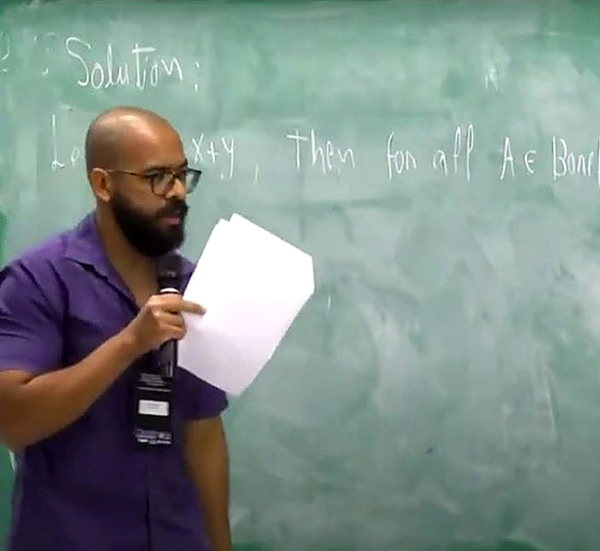

::: {.language-link}
[English](../index.html)
:::

<link rel="stylesheet" href="../assets/portrait.css">

::: {.hero .hero-with-portrait .hero-dark}

 dXt = b(Xt) dt + σ(Xt) dWt
 φt = ξt ∘ ψt
 eiπ + 1 = 0
 ∇ · u = 0
 [X,Y] = XY − YX
 ∫0t f(s) dXs
 ∂tu + (u · ∇)u = νΔu − ∇p
 𝔼[X | ℱt]
 dYt = V(Yt) d𝐙t
 a² + b² = c²
 Pn+m = PnPm
 ⟨x,y⟩ = ∑i xiyi
 limn→∞ (1 + 1/n)n = e
 ∫ℝ e−x² dx = √π
 d² = 0
 ∂tv = Δv
 det(AB) = det(A) det(B)
 F̂(ξ) = ∫ℝ F(x)e−2πixξ dx
 dω + ω ∧ ω = Ω
 ∑n=1∞ 1/n² = π²/6
 𝔓(A ∩ B) = 𝔓(A | B)𝔓(B)
 ∇ × ∇f = 0
 ‖x + y‖ ≤ ‖x‖ + ‖y‖
 (α ∧ β) = (−1)pq(β ∧ α)

::: {.hero-copy}
::: {.eyebrow}
ESPOL · Ecuador
:::
# Lourival Rodrigues de Lima {.unnumbered}

::: {.academic-role}
Matemático · Profesor en ESPOL
:::

::: {.lead}
Investigo la interacción entre procesos aleatorios, sistemas dinámicos y estructuras geométricas.
:::

::: {.research-keywords}
Análisis estocástico · Rough paths · Flujos estocásticos · SPDEs
:::

<a class="btn-academic primary" href="research.html">Investigación</a><a class="btn-academic" href="publications.html">Publicaciones</a><a class="btn-academic" href="cv.html">Currículum</a>

<a href="https://scholar.google.com/citations?user=jmDlcS8AAAAJ" target="_blank" rel="noopener noreferrer">Google Scholar</a><a href="https://orcid.org/0000-0001-6826-3315" target="_blank" rel="noopener noreferrer">ORCID</a><a href="mailto:lourodri@espol.edu.ec">Contacto</a>

:::

::: {.hero-photo}
<figure><figcaption>Durante una presentación de matemáticas.</figcaption></figure>
:::
:::

## Publicaciones seleccionadas

::: {.home-publications}
::: {.home-paper}
### Decomposition of discontinuous flows of diffeomorphisms: Jumpings, geometrical and topological aspects
Lourival Lima, Paulo Ruffino.  
*Stochastics and Dynamics*, 26(01n02), 2550039, 2026.

[DOI](https://doi.org/10.1142/S021949372550039X) · [arXiv](https://arxiv.org/abs/2501.01750)
:::

::: {.home-paper}
### Continuous functions on primal topological spaces induced by group actions
Luis Fernando Mejías, Jorge Vielma, Elvis Aponte, Lourival Rodrigues de Lima.  
*AIMS Mathematics*, 10(1), 793–808, 2025.

[DOI](https://doi.org/10.3934/math.2025037)
:::

::: {.home-paper}
### Geometric Aspects of Young Integral: Decomposition of Flows
Pedro Catuogno, Lourival Lima, Paulo Ruffino.  
*Mediterranean Journal of Mathematics*, 20(6), 335, 2023.

[DOI](https://doi.org/10.1007/s00009-023-02539-3) · [arXiv](https://arxiv.org/abs/2204.03527)
:::
:::

[Todas las publicaciones y preprints →](publications.qmd)

## Proyectos actuales

::: {.project-grid}
::: {.home-project}
### Rough paths y Navier–Stokes
Ecuaciones de fluidos con perturbaciones irregulares y transporte proyectado.

[Conoce el proyecto →](research.qmd)
:::

::: {.home-project}
### Goldbach y espacios de Alexandroff
Topología relacional y caracterizaciones topológicas asociadas a representaciones de Goldbach.

[Conoce el proyecto →](research.qmd)
:::

::: {.home-project}
### Inferencia espacial mediante SPDE
Inferencia de máxima verosimilitud para regresión espacial con respuestas censuradas y faltantes.

[Conoce el proyecto →](research.qmd)
:::
:::

## Acerca de mí

Soy profesor de Matemáticas en la Facultad de Ciencias Naturales y Matemáticas de ESPOL. Obtuve mi maestría y doctorado en Matemática en la Universidade Estadual de Campinas (UNICAMP), después de cursar mis estudios de grado en la Universidade Federal do Pará.

[Currículum académico →](cv.qmd)

::: {.section-grid}
::: {}
### Investigación
Procesos aleatorios, dinámica y estructuras geométricas. [Conoce mis líneas de investigación](research.qmd).
:::
::: {}
### Docencia y notas
Cursos de matemáticas y estadística, con espacio para notas de clase y materiales. [Explora la docencia](teaching.qmd).
:::
:::

## Contacto

[lourodri@espol.edu.ec](mailto:lourodri@espol.edu.ec)  
Facultad de Ciencias Naturales y Matemáticas · ESPOL · Guayaquil, Ecuador
