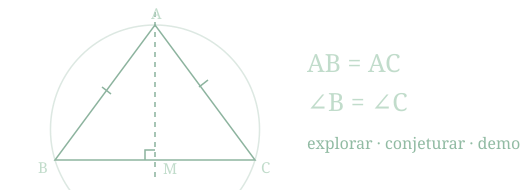
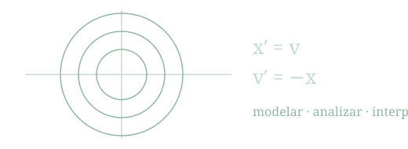

<link rel="stylesheet" href="../assets/notes.css">
<link rel="stylesheet" href="../assets/course-hubs.css">

<div class="language-link"><a href="../notes.html">English</a></div>

<header class="course-hero">
<span class="course-kicker">ESPOL · Material de estudio</span>
<h1>Un espacio para cada asignatura</h1>
<p>Elige tu asignatura para acceder a las notas, los documentos del curso y las propuestas de exploración.</p>

<div class="course-tags"><span>Notas de clase</span><span>Documentos del curso</span><span>Curiosidades</span></div>
</header>

```{=html}
<div class="course-grid">
<a class="course-card" href="notes/mathematical-methods.html">
<span class="course-kicker">MATG1075 · ESPOL</span>
<h2>Métodos Matemáticos para las Ciencias</h2>
<p>Modelación, ecuaciones diferenciales y sistemas dinámicos.</p>

<div class="course-card-footer"><span>2 notas completas + 1 nota breve</span><strong>Entrar a la asignatura <span aria-hidden="true">→</span></strong></div>
</a>
<a class="course-card" href="notes/axiomatic-geometry.html">
<span class="course-kicker">MATG1062 · ESPOL</span>
<h2>Geometría Axiomática</h2>
<p>Axiomas, construcciones y demostraciones. Figuras que puedes explorar.</p>

<div class="course-card-footer"><span>Capítulo 1 · 15 figuras interactivas</span><strong>Entrar a la asignatura <span aria-hidden="true">→</span></strong></div>
</a>
</div>
```

<div class="course-guidance"><p><strong>Material complementario.</strong> En cada página encontrarás los recursos disponibles. Para preparar tus evaluaciones, enfócate en los temas tratados en clase y consulta el Aula Virtual para las indicaciones y entregas.</p></div>
