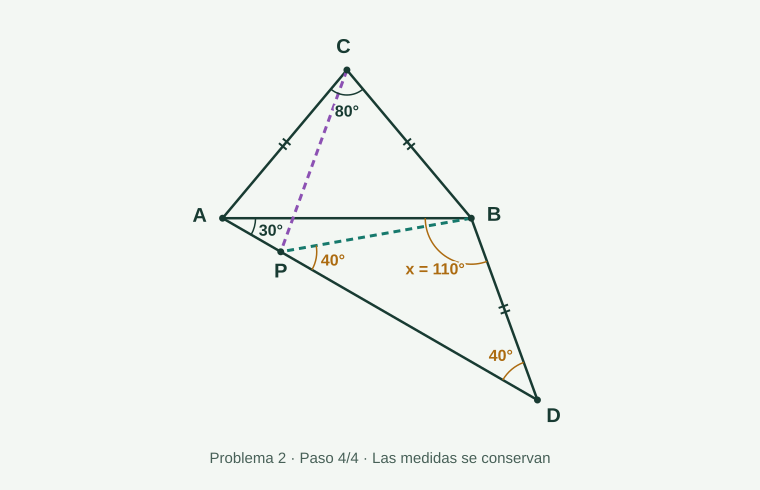
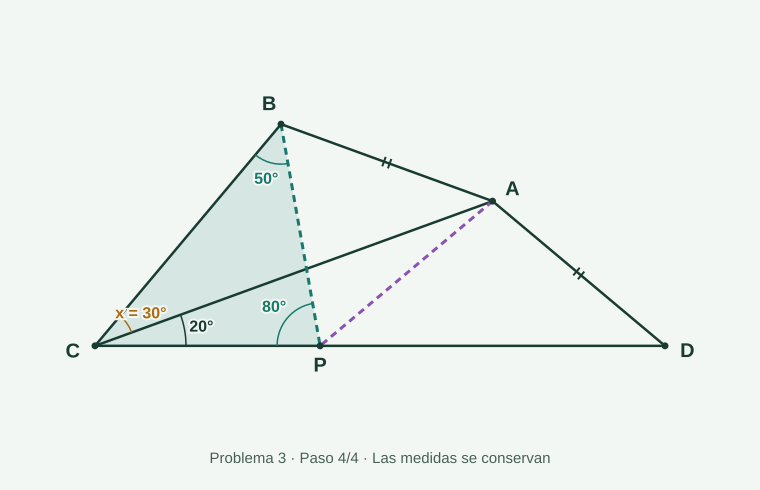

<link rel="stylesheet" href="../../assets/notes.css">
<link rel="stylesheet" href="../../assets/geometry-ch1.css">
<link rel="stylesheet" href="../../assets/axiomatic-lesson-1.css">

<div class="language-link"><a href="../../notes/axiomatic-lesson-1-solutions.html">English</a></div>

<a class="note-back" href="axiomatic-geometry.html">← Volver a la asignatura</a>

**Geometría Axiomática · MATG1062 · ESPOL**  
**Lección 1 · Material de junio de 2026 · Solucionario revisado**

<div class="note-actions"><a class="btn-academic primary" href="../../files/notes/axiomatic-lesson-1-solutions.pdf" download>Descargar solucionario PDF</a><a class="btn-academic" href="#axiomatic-lesson-figure-2">Explorar el problema 2</a><a class="btn-academic" href="#axiomatic-lesson-figure-3">Explorar el problema 3</a></div>

Las figuras se pueden recorrer por pasos, girar y reflejar. Todas las posiciones conservan las hipótesis de cada configuración. El PDF incluye dibujos vectoriales estáticos.

**Notación.** $UV$ denota la longitud del segmento de extremos $U,V$ y $\overrightarrow{UV}$ la semirrecta con origen en $U$ que pasa por $V$, con $U\ne V$.

## Problema 1 {#problema-1}

**Orientación de estudio.** Consulta el libro guía *Classical Geometry: Euclidean, Transformational, Inversive, and Projective*, de I. E. Leonard, J. E. Lewis, A. C. F. Liu y G. W. Tokarsky, páginas **14 y 15**.

## Problema 2 {#problema-2}

### Datos de la configuración

Se consideran $CA=CB=BD$, $\angle ACB=80^\circ$ y $\angle BAD=30^\circ$, con los puntos dispuestos como en la figura. Se busca

$$x=\angle ABD.$$

```{=html}
<figure class="geometry-figure" id="axiomatic-lesson-figure-2" data-axiomatic-lesson="2">
<div class="geometry-static"></div>
<div class="geometry-live"></div>
<div class="geometry-controls"></div>
<p class="geometry-readout" role="status" aria-live="polite"></p>
<figcaption><strong>Problema 2.</strong> Recorre los pasos para mostrar las construcciones auxiliares. El giro y la reflexión conservan todos los datos geométricos. <a href="../../assets/axiomatic-lesson-1/problem-2-step-0.svg" target="_blank" rel="noopener">Ver la configuración inicial</a>.</figcaption>
</figure>
```

### 1. Construcción del punto auxiliar

Como $\triangle ABC$ es isósceles y $\angle ACB=80^\circ$, sus ángulos de la base son

$$\angle CAB=\angle CBA=\frac{180^\circ-80^\circ}{2}=50^\circ.$$

Dentro de $\angle ACB$ trazamos una semirrecta que forma $20^\circ$ con $\overrightarrow{CA}$. Sea $P$ su intersección con $\overline{AD}$; en la configuración, los puntos están en el orden $A,P,D$. Por construcción,

$$\angle ACP=20^\circ.$$

Además, como $\overrightarrow{AP}=\overrightarrow{AD}$,

$$\angle CAP=\angle CAB+\angle BAD=50^\circ+30^\circ=80^\circ.$$

En $\triangle ACP$, la suma de los ángulos interiores da

$$\angle CPA=180^\circ-80^\circ-20^\circ=80^\circ.$$

Los ángulos en $A$ y $P$ son iguales. Por el recíproco del teorema del triángulo isósceles,

$$CA=CP.$$

### 2. Un triángulo equilátero

Unimos $B$ con $P$. Como $CA=CB$ por hipótesis y $CA=CP$ por el paso anterior, se obtiene

$$CP=CB.$$

Por otra parte,

$$\angle BCP=\angle BCA-\angle PCA=80^\circ-20^\circ=60^\circ.$$

Por tanto, $\triangle BCP$ es isósceles con ángulo del vértice de $60^\circ$. Sus otros dos ángulos miden

$$\angle CPB=\angle CBP=\frac{180^\circ-60^\circ}{2}=60^\circ.$$

Así, $\triangle BCP$ es equilátero y

$$CP=CB=BP.$$

### 3. Un segundo triángulo isósceles

Como $BD=CB$ por hipótesis y $BP=CB$, tenemos $BP=BD$. En consecuencia, $\triangle BDP$ es isósceles y

$$\angle BPD=\angle BDP.$$

Dado que $A,P,D$ están alineados, los ángulos consecutivos en el mismo semiplano determinado por $AD$ satisfacen

$$\angle CPA+\angle CPB+\angle BPD=180^\circ.$$

Sustituyendo los valores ya obtenidos,

$$\angle BPD=180^\circ-80^\circ-60^\circ=40^\circ.$$

Por lo tanto, $\angle BDP=40^\circ$. Como $\overrightarrow{DP}=\overrightarrow{DA}$, también

$$\angle BDA=40^\circ.$$

### 4. Cálculo de la incógnita

Finalmente, en $\triangle ABD$,

$$x+\angle BAD+\angle BDA=180^\circ.$$

De aquí,

$$\boxed{x=180^\circ-30^\circ-40^\circ=110^\circ.}$$

## Problema 3 {#problema-3}

### Datos de la configuración

Se consideran $AB=AD$, $\angle BAC=40^\circ$, $\angle ACD=20^\circ$ y $\angle ADC=40^\circ$, con la disposición indicada en la figura. Se busca

$$x=\angle BCA.$$

```{=html}
<figure class="geometry-figure" id="axiomatic-lesson-figure-3" data-axiomatic-lesson="3">
<div class="geometry-static"></div>
<div class="geometry-live"></div>
<div class="geometry-controls"></div>
<p class="geometry-readout" role="status" aria-live="polite"></p>
<figcaption><strong>Problema 3.</strong> Recorre los pasos para mostrar las construcciones auxiliares. El giro y la reflexión conservan todos los datos geométricos. <a href="../../assets/axiomatic-lesson-1/problem-3-step-0.svg" target="_blank" rel="noopener">Ver la configuración inicial</a>.</figcaption>
</figure>
```

### 1. Construcción del punto auxiliar

En $\triangle ACD$,

$$\angle CAD=180^\circ-20^\circ-40^\circ=120^\circ.$$

Dentro de $\angle CAD$ trazamos una semirrecta que forma $100^\circ$ con $\overrightarrow{AD}$. Sea $P$ su intersección con $\overline{CD}$; los puntos están en el orden $C,P,D$. Entonces,

$$\angle PAD=100^\circ,\qquad \angle CAP=120^\circ-100^\circ=20^\circ.$$

En $\triangle ADP$, como $\overrightarrow{DP}=\overrightarrow{DC}$,

$$\angle ADP=40^\circ.$$

Por la suma de los ángulos interiores,

$$\angle APD=180^\circ-100^\circ-40^\circ=40^\circ.$$

Así, $\angle APD=\angle ADP$; por el recíproco del teorema del triángulo isósceles,

$$AP=AD.$$

### 2. Un triángulo equilátero

Unimos $B$ con $P$. La hipótesis $AB=AD$ y la igualdad $AP=AD$ implican

$$AB=AP.$$

Además,

$$\angle BAP=\angle BAC+\angle CAP=40^\circ+20^\circ=60^\circ.$$

El triángulo $ABP$ es isósceles con ángulo del vértice de $60^\circ$; sus otros dos ángulos también miden $60^\circ$. Por consiguiente, es equilátero y

$$AB=AP=BP.$$

### 3. La igualdad que conecta ambos triángulos

En $\triangle ACP$ tenemos

$$\angle CAP=20^\circ,\qquad \angle ACP=\angle ACD=20^\circ.$$

Los lados opuestos a estos ángulos son, respectivamente, $CP$ y $AP$. Por tanto,

$$AP=CP.$$

Junto con $BP=AP$, obtenido en el paso anterior, esto da

$$\boxed{BP=AP=CP.}$$

En particular, $\triangle BCP$ es isósceles porque $BP=CP$.

### 4. Cálculo de la incógnita

Como $C,P,D$ están alineados, los ángulos consecutivos del semiplano que contiene a $A$ y a $B$ cumplen

$$\angle BPC+\angle APB+\angle APD=180^\circ.$$

Por ello,

$$\angle BPC=180^\circ-60^\circ-40^\circ=80^\circ.$$

Los ángulos de la base del triángulo isósceles $BCP$ son

$$\angle PBC=\angle PCB=\frac{180^\circ-80^\circ}{2}=50^\circ.$$

Como $\overrightarrow{CP}=\overrightarrow{CD}$ y $CA$ queda dentro de $\angle PCB$,

$$\angle PCB=\angle BCA+\angle ACD=x+20^\circ.$$

En consecuencia,

$$\boxed{x=50^\circ-20^\circ=30^\circ.}$$

## Para revisar tu razonamiento {#revision}

- Distingue los **datos** de las igualdades que se demuestran durante la solución.
- Si dos ángulos de un triángulo son iguales, identifica con cuidado los **lados opuestos**.
- Antes de sumar ángulos para obtener $180^\circ$, indica qué puntos están alineados y en qué orden se encuentran.
- Girar o reflejar una figura no cambia sus longitudes ni sus ángulos. Las imágenes interactivas ayudan a seguir las construcciones, pero no sustituyen las demostraciones.

<script src="../../assets/axiomatic-lesson-1.js" defer></script>
