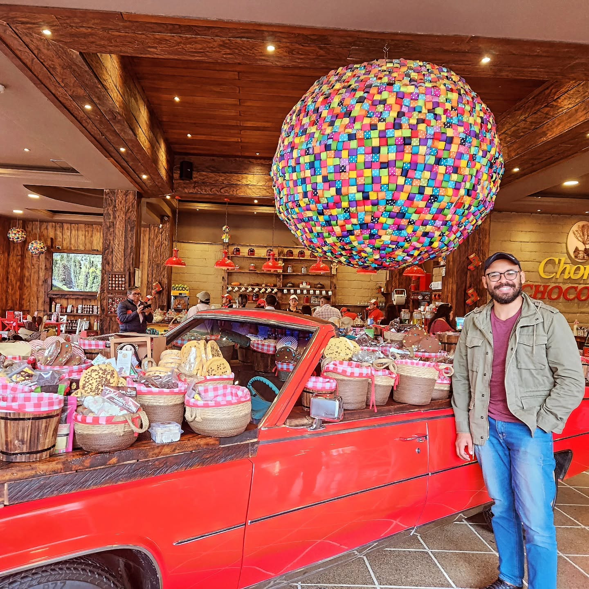

::: {.language-link}
[Español](es/index.html)
:::

<link rel="stylesheet" href="assets/portrait.css">

::: {.hero .hero-with-portrait}
::: {.hero-copy}
::: {.eyebrow}
Mathematics · ESPOL · Ecuador
:::
# Lourival Rodrigues de Lima {.unnumbered}
::: {.lead}
I am a mathematician and professor at Escuela Superior Politécnica del Litoral (ESPOL). My research focuses on stochastic analysis and stochastic dynamical systems, with interests in rough paths, stochastic flows, and stochastic partial differential equations.
:::

<a class="btn-academic primary" href="research.html">Explore research</a><a class="btn-academic" href="publications.html">Publications</a><a class="btn-academic" href="cv.html">Academic CV</a>

:::

::: {.hero-photo}
{width=280 height=350 loading="eager"}
:::
:::

## About me
I teach mathematics at ESPOL's Faculty of Natural Sciences and Mathematics. I obtained my master's degree and doctorate in Mathematics at Universidade Estadual de Campinas (UNICAMP), following undergraduate studies at Universidade Federal do Pará.

::: {.section-grid}
::: {}
### Research
Random processes, dynamics, and geometric structures. [Explore my research interests](research.qmd).
:::
::: {}
### Teaching and notes
Mathematics and statistics courses, with a growing space for lecture notes and course materials. [Explore teaching](teaching.qmd).
:::
:::
